# AsyncPP: letting every pipeline stage of LLM prefill run on its own clock

In prefill/decode (PD) disaggregated serving, prefill is often spread over several GPUs with pipeline parallelism
(PP). Each GPU holds a contiguous range of layers, and micro-batches flow through the stages one after another.
Ideally the pipeline emits one micro-batch every time its slowest stage finishes a forward.

In SGLang's PP prefill loop, however, every stage met its neighbours on the host once per micro-batch. The pipeline
marched in step. Its pace was set by the slowest micro-batch in flight in each beat, plus the time it took everyone
to line up.

AsyncPP removes all of that lining up and keeps only the real data dependencies. A stage now waits for exactly
two things:
- the previous stage's activations for this micro-batch;
- its own prefix KV for this micro-batch, loaded back from host memory.

When both are ready, the stage starts. Nobody tells it to.

Results on Kimi-K3.1-Pro, 8 stages, 2 VR200 nodes:
- **Three arms on the same nodes (test bench, 300 s each):** against lockstep with the three host fixes off, the fully
  asynchronous loop cuts the beat from 203.0 to 183.0 ms (−9.9%) and raises PP0 new tokens per second from 77.4k to
  88.8k (+14.7%), with the hit rate unchanged. Lockstep with all three fixes on sits in between: 199.9 ms, 80.4k.
- **Decoupling the loop alone:**
  - the beat shrinks 6.2–6.9%;
  - new tokens per second through PP0 rise 7.1–8.1%;
  - the beat drops from 1.04–1.06× the slowest stage's forward to 1.00×.
- **Adding a copy-engine activation push and a boot-time per-GPU layer split:** against the decoupled configuration
  in use today, the beat shrinks a further 3.8–4.6%, with the prefix-cache hit rate unchanged.

The post goes from the problem, to why lockstep stalls, to the key idea, the design, the evidence, the results and
what is left. Figures marked *schematic* are drawn to scale from a simple model. Figures marked *measured* come from
CUDA events around every forward.

---

## 1. The problem: the beat is slower than the slowest stage

The setup is one PD prefill worker:
- Kimi-K3.1-Pro, 93 layers, split into 8 stages of one GPU each (TP1), over 2 VR200 nodes with 4 GPUs each;
- micro-batches of about 16k new tokens;
- each stage sends the KV of its own layers to decode.

The model mixes linear-attention (KDA) and sparse full-attention (DSA) layers. It also carries an attention-residual
bank in 12-layer blocks and hidden-state snapshots for a draft model. So the activation message between stages grows
with depth: PP0 sends 672 MiB and PP6 sends 2,688 MiB.

Three quantities describe the pipeline:
- **Beat T:** the time between consecutive micro-batches entering PP0.
- **Slowest-stage time:** the longest mean forward among the 8 stages. Without moving layers or GPUs, the beat cannot
  be shorter.
- **Mean forward over the 8 stages:** the floor once layers are perfectly balanced.

On the test bench, lockstep with the three host fixes off beat at 203.0 ms while the slowest stage needed only
180.8 ms: 1.12×. With the fixes on it was 199.9 against 186.6 ms: 1.07×. In real serving
the ratio was 1.15–1.19×. That serving figure was measured on a lockstep build that already had three host fixes: the
early last-chunk KV send, the deferred checkpoint release, and release decided by PP0. The excess has two layers:
- **Uneven micro-batches.** Every lockstep beat waits for the slowest of the 8 micro-batches in flight. That adds
  16–21 ms per beat.
- **Host-side relay and stalls** add another 4–14 ms.

One more data point shows that the time is not lost in compute. Rebalancing the layers in lockstep cut the slowest
stage from 187.8 to 177.0 ms, yet the beat only moved to 195.6 ms.

---

## 2. Why lockstep stalls

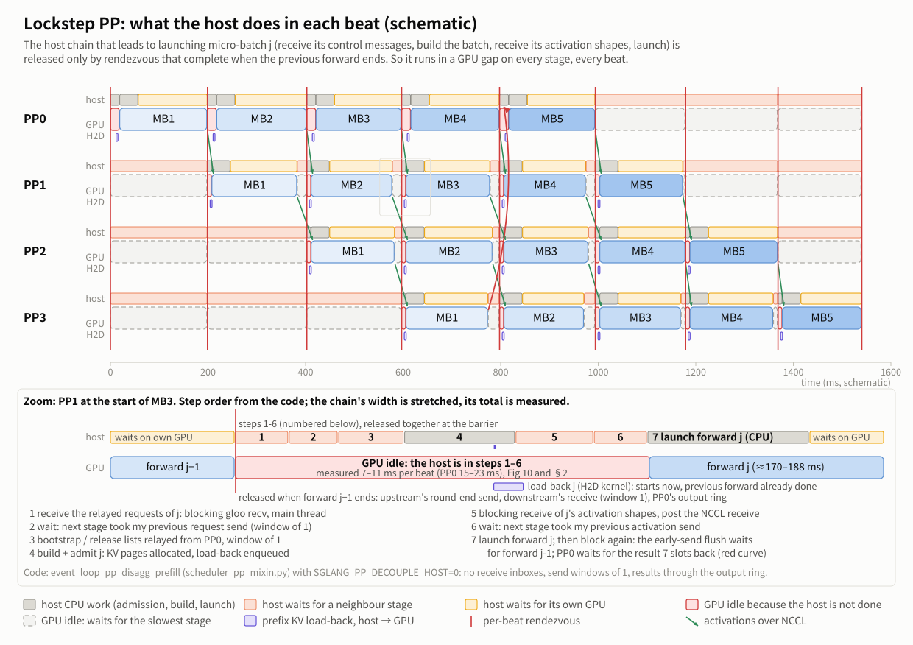

*Figure 1 (schematic): a lockstep pipeline of 4 stages and 5 micro-batches, stage costs within 3% of each other. Red
lines are the per-beat rendezvous, grey slivers its host cost, dashed boxes idle time. Even with near-equal stages,
every stage loses time at every barrier.*

In the old loop, every stage ran the same steps for every micro-batch:
1. blocking receive of the requests relayed from upstream;
2. wait for its own previous send to complete;
3. agree with PP0 on bootstrap and release lists;
4. build the batch;
5. blocking receive of the activation shapes, then post an NCCL receive;
6. wait until the downstream stage has taken the previous activation send;
7. launch the forward;
8. on PP0 only, wait for the sampled result of the micro-batch launched 7 slots earlier to come back around from the
   last stage.

PP0 never issued a "start now" command. The marching in step emerged from these synchronizations: each one tied a stage
to its predecessor or successor, and enough of them locked the pipeline into one beat.

The table lists the synchronizations that cost performance or caused trouble. "If not ready" says what happened when
the condition was not yet met:
- **block:** the host thread stalls;
- **spin:** a kernel holds the GPU while it waits;
- **skip:** this round is skipped and retried next round.

| sync point | waits for | if not ready | measured cost |
|---|---|---|---|
| receiving relayed requests and activation shapes | the upstream host to send this micro-batch's messages | block: the main thread sits in a gloo recv and the GPU idles | 1–23 s per minute on non-first stages |
| send waits for the peer's receive (requests, activations, bootstrap / release / HiCache counts; window 1) | the downstream stage to take the previous round | gloo send: block. NCCL send: the send kernel spins on the GPU | upstream can lead by at most one round, so the whole pipeline locks into one beat |
| output ring | the sampled token of the micro-batch 7 slots earlier, back at PP0 | block: PP0's host sits on a D2H event | 20–42 s per minute on every stage |
| flush before the early KV send | "the previous forward" to finish. Once the host runs ahead, that is the forward just launched | block: the host sits in `event.synchronize()` | 23% of the last stage's host time during its forward |
| resident NCCL kernels (exposed after decoupling) | the peer to post its receive or send its data | spin: the NCCL kernel holds SMs and the cooperative MoE routing kernel queues | the waiting side's forward runs 3–8% longer |
| release lists and write-back acks | the downstream stage to take the list; this rank's own write-back copy | block. Requests whose transfer is not done are skipped: not freed this round, retried next | the release relay is among the top host waits in serving; L3 acks blocked 174–870 ms per minute |

On the test bench, lockstep GPU busy was only 71–89% per stage before the host fixes and 74–93% with them (section
5.1). Even PP0 waited 15–23 ms before every forward.

---

## 3. The key idea: keep only the data dependencies

Ask of each row above "is this a data dependency?" and the answer is almost always no:
- waiting for a peer to receive, waiting for results to come back around and window-1 relays all come from the way
  the loop was written;
- only two things cannot be avoided:
  1. **the previous stage's activations for this micro-batch.** This is the model's own data dependency. The
     micro-batch's control messages come from upstream together with it.
  2. **this stage's prefix KV for the micro-batch, loaded back into GPU memory.** This dependency is local and has
     nothing to do with other stages.

Everything else is a *credit*: a send window or a slot in the next stage's input ring. A credit binds only when a stage
runs several micro-batches ahead of its successor, so in steady state it never binds.

Without the synchronization, it has to be precise about who decides what:
- **Batch content: decided by PP0, identical on every stage.**
  - PP0 decides which requests run, how the batch is formed and which tokens each request computes.
  - PP0's inputs (new requests, bootstrap results, release lists, HiCache counts) are relayed hop by hop. Every stage
    replays PP0's scheduler on those inputs in the same order, so it builds exactly PP0's batch.
  - Every activation message carries a batch tag (request count, new-token count, a hash of the request ids). The
    receiver checks it and stops with an error on a mismatch.
- **When to start: each stage decides for itself.**
  - A stage starts as soon as its two inputs are ready. PP0 never says "start now".
  - If upstream is fast, the input arrives early. If downstream falls behind, upstream runs ahead until its credits
    are used up.

One rule makes independent stages safe:
- every input that changes scheduler or cache state is tagged by PP0 with the epoch (micro-batch number) at which it
  takes effect, and each stage applies it when it reaches that epoch;
- nothing a stage observes locally may change shared state directly, for example a copy finishing, a KV transfer
  completing, a background thread receiving a message, or a GC;
- so a stage running fast or slow cannot change what another stage computes.

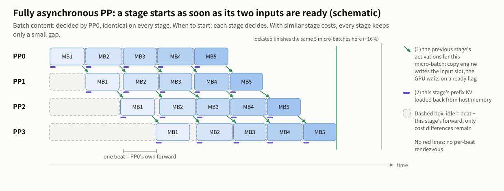

*Figure 2 (schematic): the same 4 stages, 5 micro-batches and near-equal costs. Green arrows are activation hand-offs;
violet ticks mark this stage's prefix KV loaded. Without the rendezvous, every stage keeps only a small hand-off gap
between forwards. Lockstep needs 16% longer for the same 5 micro-batches.*

In the asynchronous loop, a stage's idle time is the beat minus its own forward time. So the only gaps left come from
per-stage cost differences (imbalance), not from synchronization.

Each stage's loop then looks like this. It can only wait at the red nodes:

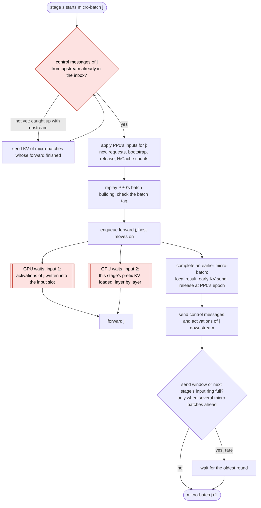

---

## 4. Design: removing the synchronizations one by one

### 4.1 Per-micro-batch host handshake → background inbox threads

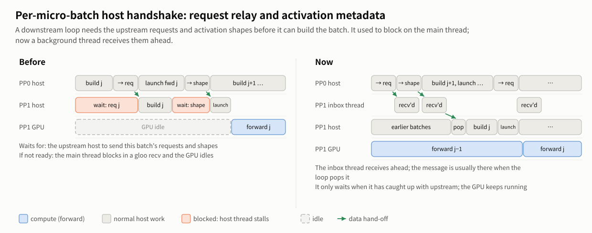

*Figure 3 (schematic): the downstream main thread used to block on upstream messages; now a background thread receives
them ahead.*

Every relay channel gets a background receive thread (`PPRecvInbox`). It runs the blocking receive back to back, up to
`pp_size + pp_async_batch_depth` messages ahead, and the loop pops messages that have usually already arrived.
- A thread is needed because a gloo `irecv` cannot be polled: `is_completed()` stays False until `wait()`, and a
  `wait()` with a timeout tears down the group.
- The activation channel's thread receives only the CPU half of the message (the new `recv_tensor_dict_host_part`).
  Device data stays with the loop.
- gloo matches receives in posting order, so all receives of a channel go through its thread and order is preserved.

### 4.2 Window-1 reverse waits → send windows

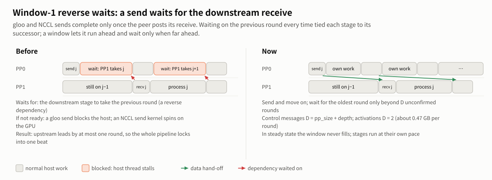

*Figure 4 (schematic): every round used to wait for the downstream receive (red reverse arrows); now a send is not
waited on.*

Every send channel gets a send window (`PPSendWindow`):
- Up to `pp_size + pp_async_batch_depth` rounds stay un-waited. Only rounds beyond that are waited, oldest first, and
  each send exactly once: a gloo send waited twice never returns, which later got its own unit test.
- Activations get their own window of 2 rounds (`SGLANG_PP_DECOUPLE_TENSOR_WINDOW`). A round holds its GPU memory until
  waited: about 0.47 GB for hidden plus residual at 16k tokens. The first version gave activations the 10-round window
  too, pinned about 4.2 GB more per stage, and OOMed in the DSA indexer 48 s into warm-up.

### 4.3 Output ring → each stage completes its own result

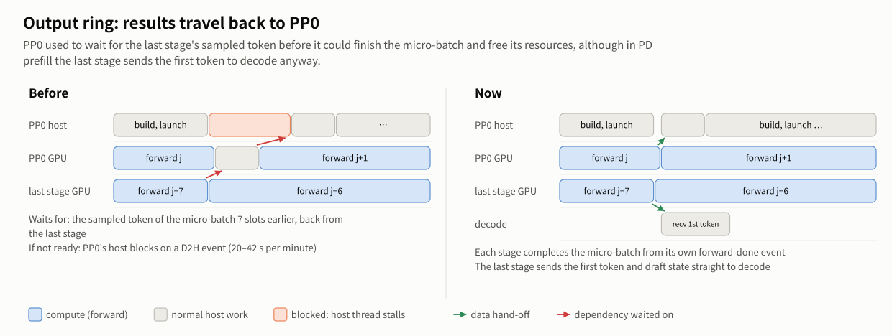

*Figure 5 (schematic): PP0 used to wait for results to come back around; now each stage completes from its own forward
event and the first token goes straight to decode.*

In PD prefill the decode side already takes the first token from the last stage, so the ring is redundant there. The
new path (`SGLANG_PP_PD_LOCAL_RESULT`):
- The last stage processes its own output and alone sends the first token and draft state to decode.
- Earlier stages complete the micro-batch from a placeholder result on the host once their own forward event has fired,
  so reading it never waits on the GPU.
- Batches with logprobs, grammar, sampling masks or routed experts still use the ring.

The same change fixed the early-KV-send flush: it waits only for this micro-batch's own forward, not the one just
launched. While waiting for upstream input, the loop sends the KV of forwards that have already finished.

### 4.4 Resident NCCL kernels → copy-engine activation push

Once the loop was decoupled, the bottleneck stage ran its forwards back to back, but the last stage's forward grew from
157 to 184 ms. A CUPTI trace found the cause:
- The MoE routing kernel `routingIndicesCoopKernel` is a cooperative launch: it needs every SM free at once.
- At that moment the only other kernel on the GPU is an NCCL SendRecv waiting for its peer, holding SMs.
- Per forward, the compute stream idled 45 ms on the last stage and 28 ms on PP0.
- In lockstep these NCCL kernels ran in the gaps between forwards, so this never showed.
- Posting the receive later did not help: it only moves the spin from the receiver to the sender.

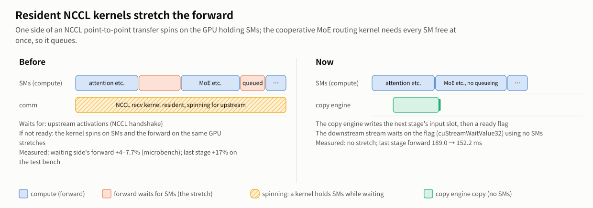

*Figure 6 (schematic): a resident NCCL kernel made the cooperative kernel queue; now the copy engine copies and the
stream waits on a flag, using no SMs.*

The new data path (`SGLANG_PP_CE_PUSH`) uses no kernel at all:
- **Input ring.** Every stage after the first allocates a 2-slot input ring and a set of "full" flags in CUDA VMM
  FABRIC memory. The upstream stage holds a set of "free" flags. They are exported and mapped once at startup, which
  also works across nodes over multi-node NVLink (MNNVL).
- **Push.** Micro-batch j uses slot j mod 2:
  1. the upstream push stream waits for the forward and for the slot's "free" flag;
  2. the copy engine copies hidden states, the residual bank and the draft snapshots into the downstream slot, then
     writes the "full" flag;
  3. the downstream forward stream waits on the "full" flag with `cuStreamWaitValue32`, and the forward reads the slot
     in place;
  4. after the downstream stage's own push has read the slot, it writes the "free" flag back.
- **No host waits, no resident kernels.** Stream memory operations cannot target memory imported from another node, so
  a flag is written to a local word and copied over by the copy engine, ordered after the data.
- **Slot size per stage.** Activations grow with depth, so slots are sized per stage (`SGLANG_PP_CE_PUSH_SLOT_MB`, or
  `auto` from the model's reported bytes per token): 673 to 2,689 MiB for PP1 to PP7 at 16k tokens.
- **Fallback.** A message that does not fit goes over NCCL and is counted. Measured: 0 fallbacks on every stage, and
  0.7–3.3 ms per push on average.

vLLM shipped the same copy-engine mechanism for its PP transport this month (section 7). This work arrived at it
independently, for the cooperative-kernel stretch above.

A two-process microbenchmark with a cooperative kernel in a synthetic forward confirms the mechanism:
- under NCCL, the waiting side's forward was 4–7.7% slower, on one node and across nodes;
- under the copy-engine push, the forward was unchanged; the wait showed up only as idle time before the forward.

### 4.5 Release and write-back acks → asynchronous, epoch-tagged, acknowledged late

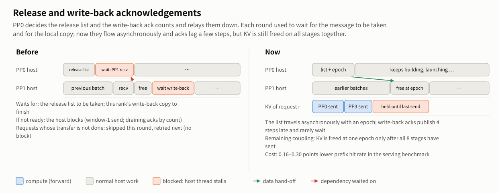

*Figure 7 (schematic): release lists used to wait for the downstream receive every round and acks waited for the local
copy; now both flow asynchronously and acks lag, but KV is still freed only after all stages have sent.*

**KV transfer does not block compute.** Each stage sends the last KV chunk of its own layers as soon as its own forward
ends. For an early-sent request, the checkpoint release waits until its transfer ends.
- Whether to defer is decided from early-send membership, which is the same on every stage.
- Deciding from "has this stage finished sending" would be local state and would let stages diverge.

**Release still happens on all stages together.**
- PP0 takes the minimum of each request's transfer status over the 8 stages. Once all are done, it relays the release
  list tagged with an epoch, and every stage frees those requests at that epoch.
- The message goes through a send window, so it never blocks compute. Requests whose transfer is not done are skipped
  this round and retried at the next.
- Release has to be joint because request slots and KV page indices come from the stages' replicated allocators and
  are the same numbers everywhere. A stage that freed its pages as soon as its own send finished would build a
  different allocator state at the next admission.

This is the coupling that remains. Its cost shows in the serving benchmark (640 concurrent agentic sessions, three
windows, against lockstep):

| | lockstep | decoupled loop |
|---|---|---|
| requests waiting for KV transfer, per worker | 4.4–5.7 | 12–14 |
| PP0 device KV use (mean) | 0.42–0.48 | 0.55–0.61 |
| transfer queue wait p50 | about 125 ms | about 310 ms |
| total prefix hit, three windows | 0.9450 / 0.9448 / 0.9458 | 0.9425 / 0.9432 / 0.9429 |

- With prefill running ahead, more requests hold device KV while queued for transfer, which leaves less device memory
  for cached prefixes.
- Device-tier hits fall 0.30–1.61 points, the host tier wins back 0.22–1.45 points, and the net loss is 0.16–0.30
  points.
- The queue sits in the 4 serial transfer workers per stage. Each is about 70% busy, with a heavy send-time tail.
  Neither RDMA bandwidth nor decode is the limit.

**Write-back acks are published 4 steps late.**
- PP0 counts finished write-backs and every stage acknowledges the same count at the same epoch. A stage whose own
  write-back has not finished waits there.
- So PP0 publishes only counts that were ready 4 steps earlier (`SGLANG_HICACHE_L3_ACK_LAG_STEPS=4`). L3 ack blocking
  fell from 174–870 ms to 0.4–7.8 ms per minute.
- Device-tier write-back acks have no lag yet, but on the slowest stage that wait is hidden behind GPU work: its GPU is
  busy 99.5% of the time.

### 4.6 Once the synchronization is gone: a boot-time per-GPU layer split

> **Status (2026-11-22): under rework, see PR 9/9 ([#52199](https://github.com/sgl-project/sglang/pull/52199), back in
> draft).** In production serving on 2026-11-22, the automatic split moved the bottleneck off PP0. Work then queued
> inside a deeper pipeline, and throughput fell by about 3.5%. The per-GPU split results in sections 5 and 6 were
> measured on 2026-11-21 and are kept as measured.

With the synchronization gone, the beat is set by the slowest stage's forward, and the layer split finally matters.
But the same stage runs at different speeds on different GPUs, by more than moving whole layers can recover:
- All GPUs run under the software power cap, at mean SM clocks of 1,832 to 2,019 MHz. Forward time follows the clock
  about 1:1.
- Fitted per-GPU speed factors span 0.96 to 1.05.
- After swapping GPUs, the slow one stays slow, whichever stage it runs.
- One hand-made "more balanced" split gained nothing: the beat moved onto the two lowest-clocked GPUs (1,795 and
  1,805 MHz).

So the split is chosen at boot, before the weights load, from each GPU's measured speed (`SGLANG_PP_PARTITION_AUTO`):
1. **Measure.** All GPUs run a 20 s GEMM-plus-copy burn at the same time, after a barrier.
   - The measured spread is stretched 1.25× to match the serving spread.
   - Burn factors correlate with serving-fitted factors at r = 0.87–0.93.
   - Two boots on the same GPUs agreed within 0.012.
2. **Gather.** All GPUs all-gather their speeds; a stage takes its slowest GPU's.
3. **Search.** Every GPU runs the same deterministic dynamic program: the contiguous split that minimizes the slowest
   stage's cost × speed factor. Constraints:
   - each stage keeps at least one full-attention and one linear-attention layer (otherwise the HiCache host pool fails
     at boot);
   - KV capacity stays at or above a fraction of the reference split's;
   - memory headroom is kept for the input ring, in-flight sends, the indexer logits and a margin.
4. **Agree.** Rank 0 broadcasts its split; every GPU checks that it computed the same and stops otherwise. Then
   `SGLANG_PP_LAYER_PARTITION` is set.

Per-layer cost is estimated by layer type: 27.4 ms for full attention and 10.4 ms for linear attention at 16k tokens.

---

## 5. Evidence

### 5.1 Three arms on the same nodes: before the fixes, today, fully asynchronous

To put "before the fixes" on the same scale, three arms ran back to back on the same 2 nodes and GPUs, with 300 s
windows. The boot logs confirm each arm's switches:
- **(1) Lockstep before the fixes:** the three host fixes are off (early KV send, deferred checkpoint release,
  PP0-decided release).
- **(2) Lockstep today:** all three fixes on.
- **(3) Fully asynchronous:** decoupled loop, copy-engine push and the boot-time per-GPU split (here
  12,12,12,12,12,11,12,10).

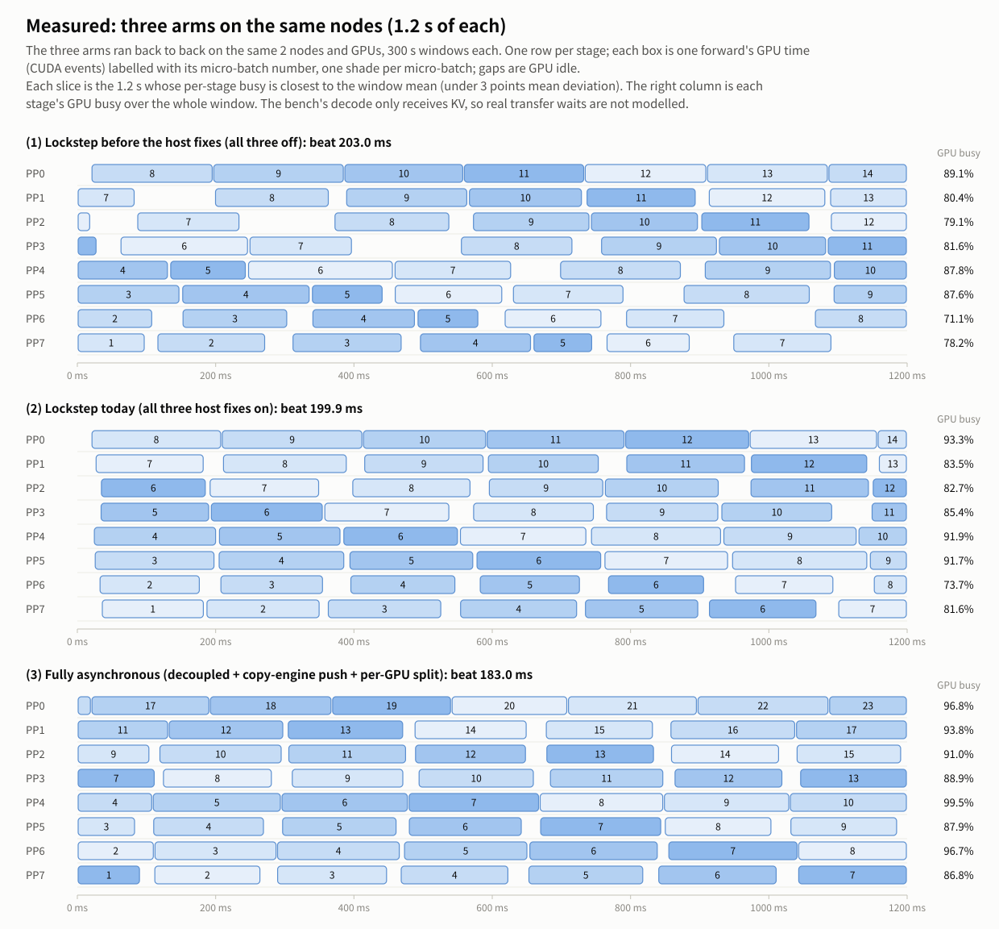

*Figure 8 (measured): for each arm, the 1.2 s slice whose per-stage busy is closest to the window mean. One row per
stage; each box is one forward's GPU time labelled with its micro-batch number, one colour per micro-batch. The right
column is the stage's GPU busy over the 300 s window.*

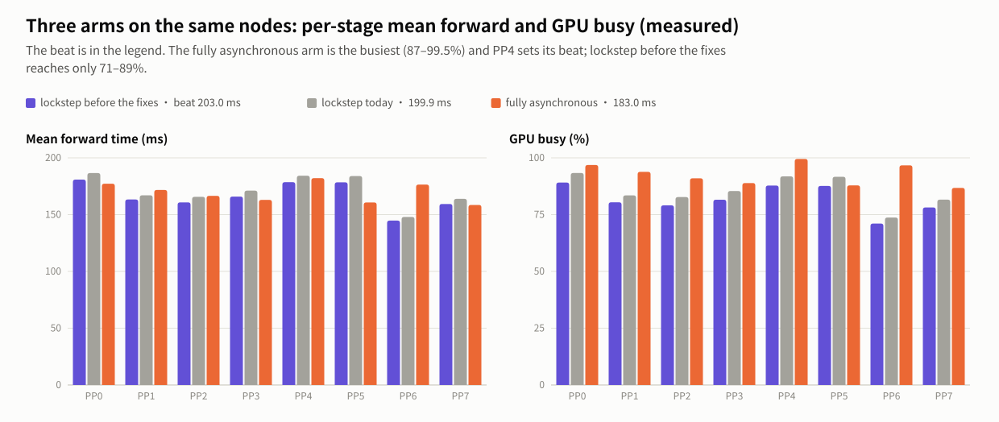

*Figure 9 (measured): per-stage mean forward and GPU busy of the same three arms; axes start at 0.*

The numbers behind Figures 8 and 9, as "mean forward ms / GPU busy %":

| stage | (1) lockstep before the fixes | (2) lockstep today | (3) fully asynchronous |
|---|---|---|---|
| PP0 | 180.8 / 89.1 | 186.6 / 93.3 | 177.2 / 96.8 |
| PP1 | 163.3 / 80.4 | 167.0 / 83.5 | 171.7 / 93.8 |
| PP2 | 160.8 / 79.1 | 165.7 / 82.7 | 166.5 / 91.0 |
| PP3 | 165.9 / 81.6 | 171.2 / 85.4 | 163.0 / 88.9 |
| PP4 | 178.6 / 87.8 | 184.2 / 91.9 | 182.1 / 99.5 |
| PP5 | 178.5 / 87.6 | 184.0 / 91.7 | 160.7 / 87.9 |
| PP6 | 144.7 / 71.1 | 148.0 / 73.7 | 176.5 / 96.7 |
| PP7 | 159.3 / 78.2 | 163.9 / 81.6 | 158.5 / 86.8 |
| beat T (ms) | 203.0 | 199.9 | 183.0 |
| T / slowest stage | 1.122 | 1.071 | 1.005 |
| PP0 new tok/s | 77,419 | 80,414 | 88,800 |
| prefix hit | 0.9594 | 0.9592 | 0.9593 |

**What the before-fixes arm shows:**
- The beat is 203.0 ms, 1.12× the slowest stage (PP0, 180.8 ms). Busy is 71–89%, and every forward waits 23–59 ms
  before it starts.
- Where the waiting goes: PP0 spends about 45 s per minute on the output ring's D2H, and PP1–PP3 spend 26–34 s per
  minute waiting for upstream requests or activation messages.
- The three host fixes cut the wait before each forward by about 6–8 ms, but the beat only drops 1.5% (203.0 → 199.9
  ms), and PP0 new tokens per second rise 3.9%.
- The asynchronous loop takes another 8.5% off, to 183.0 ms, which is 9.9% below the before-fixes arm:
  - PP0 new tokens per second reach 88,800: +10.4% over lockstep today, +14.7% over before the fixes;
  - busy is 87–99.5%, the slowest stage PP4 reaches 99.5%, and the beat is only 0.5% above its forward;
  - the hit rate is 0.959 in all three arms.

**The bench's limit.** Its decode only receives KV: a transfer counts as done the moment it is sent. The three host
fixes mostly target waiting on real KV transfers: results waiting for transfers, checkpoint releases waiting for
transfers, and the cross-stage release relay. Most of that does not happen here. So the 1.5% from (1) to (2) is a
lower bound; the effect under real transfers is in the serving benchmark (section 6).

**(2) has longer forwards and shorter waits than (1).** Every stage's mean forward is 2.3–3.2% longer in (2), and the
wait before each forward is 6–8 ms shorter. A plausible reading is that the early KV send moves the preparation and
hand-off of each micro-batch's last KV chunk from between forwards into the stage's forward interval. This is a
hypothesis; no kernel-level trace has confirmed it.

### 5.2 What the push and the split each do

The asynchronous arm in 5.1 turns on three things at once. Below are earlier measurements on two other node pairs that
separate them.

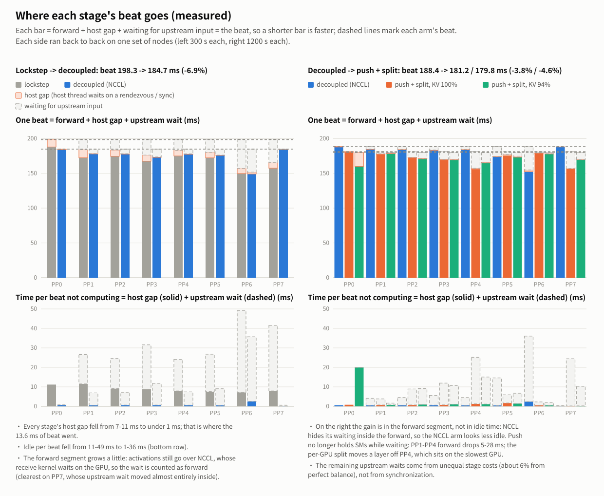

*Figure 10 (measured). Each bar is one stage's time per beat, split into forward, host gap (the host thread waits on a
rendezvous or sync) and waiting for upstream input; the three add up to the beat, so a shorter bar is faster. The bottom
row shows only the last two, the time per beat spent not computing. Left: lockstep vs decoupled (NCCL activations) on one
node pair (300 s each). Right: on another pair, decoupled (NCCL) vs push plus per-GPU split at KV floors of 100% and 94%
(1200 s each). Axes start at 0.*

On the left the gain is not in the forward but in the gaps: under lockstep every stage loses 7-11 ms of host gap per
beat; decoupled, under 1 ms, and the beat goes 198.3 -> 184.7 ms. The forward segment grows a little, because activations
still go over NCCL and its receive kernel holds SMs while it waits for upstream, so that wait is counted as forward
(clearest on PP7). On the right the gain is in the forward segment: push no longer holds SMs while waiting, the forward
drops back, and the beat goes 188.4 -> 181.2 ms.

The numbers behind Figure 10, as "mean forward ms / GPU busy %":
| stage | lockstep | decoupled (NCCL) | decoupled (NCCL), other pair | push + per-GPU split, KV 100% | push + per-GPU split, KV 94% |
|---|---|---|---|---|---|
| PP0 | 187.8 / 94.7 | 183.9 / 99.6 | 187.9 / 99.7 | 180.3 / 99.5 | 159.9 / 88.9 |
| PP1 | 172.4 / 86.9 | 177.8 / 96.3 | 184.3 / 97.8 | 177.3 / 97.9 | 178.2 / 99.1 |
| PP2 | 174.4 / 87.9 | 177.5 / 96.1 | 183.9 / 97.6 | 172.3 / 95.1 | 170.7 / 94.9 |
| PP3 | 167.4 / 84.3 | 173.0 / 93.6 | 182.9 / 97.0 | 169.2 / 93.4 | 169.2 / 94.1 |
| PP4 | 174.9 / 88.0 | 177.3 / 96.0 | 183.9 / 97.6 | 156.0 / 86.1 | 164.8 / 91.6 |
| PP5 | 172.2 / 86.6 | 175.7 / 95.1 | 173.9 / 92.2 | 175.2 / 96.7 | 173.2 / 96.2 |
| PP6 | 149.7 / 75.3 | 149.1 / 80.7 | 152.4 / 80.9 | 178.9 / 98.8 | 177.9 / 98.9 |
| PP7 | 157.4 / 79.1 | 184.1 / 99.7 | 187.9 / 99.7 | 156.7 / 86.5 | 169.6 / 94.3 |
| beat T | 198.3 | 184.7 | 188.4 | 181.2 | 179.8 |
| layer split | 12,…,12,11,10 | same | same | 12,12,12,12,11,12,12,10 | 11,12,12,12,11,12,12,11 |

What to look for:
- **Decoupling takes the bottleneck stages to about 100% busy.**
- **The NCCL stretch pushes every waiting stage up to the beat (183–184 ms on PP1–PP4 on the other pair), which also
  hides the imbalance.**
- **Once the push removes the stretch, the per-GPU split moves a layer off PP4, which runs on the slowest GPU.** At
  KV floor 94% it also moves one from PP0 to PP7.
- **On the same node pair, push plus split and the NCCL-decoupled loop have about the same mean busy (94.3% vs
  95.3%).** The speed-up comes from shorter forwards, no longer stretched by NCCL, not from less idle. The idle that
  remains comes from per-stage cost differences: the "about 6% from perfect balance" in section 8.

### 5.3 Correctness

**Stage state agrees:**
- In debug mode, every stage logs a digest every few epochs (the batches it built, the request-to-slot map), compared
  by epoch. In the final 1200 s run, 116 epochs showed 0 mismatches.
- The per-activation batch tag stays on in production. It fired only before the profiler bug in 5.4 was fixed.

**Outputs agree:**
- 16 prompts run one at a time, which rules out batching effects: lockstep, decoupled and re-split builds produce
  bit-identical output ids and logprobs.
- The same 16 prompts run together: identical first tokens, 16/16. Logprob differences ≤ 0.067, the same as between two
  lockstep runs.
- 48 natural-text prompts: bit-identical when run alone. Run together: 48/48 identical first tokens, top-20 KL at most
  0.027.

**Long-prompt KL:**
- 64 prompts of 15.8k–20.4k tokens, 60 of them spanning two chunks, on the push build: 0 greedy mismatches; KL median
  7.2e-7, max 2.2e-2.
- The lockstep-vs-lockstep spread over 120 pooled pairs is max 3.69e-2 and p95 9.26e-3. The push build stays within 2×
  that max, with as many prompts above p95 as the previously accepted decoupled build.

**Copies are byte-exact.** A debug switch (`SGLANG_DEBUG_PP_CE_CHECKSUM`) makes both ends sum every tensor of every
message, on the full model under load:
- 7 hops × 3,000 messages × 3 tensors: 21,000 messages and 63,000 sums;
- 0 mismatches, and every sum is non-zero.

**Accuracy and long runs:**
- GSM8K on a real PD deployment, 64 concurrent: 0.9818; earlier lockstep builds scored 0.9788 and 0.9818.
- In the final A/B, the three 1200 s arms completed 17,098 / 17,732 / 17,838 requests with 0 failures and 0
  fallbacks.

### 5.4 What broke on the way

Removing the synchronization exposed timing bugs that lockstep had hidden:

| symptom | cause | fix |
|---|---|---|
| with the torch profiler on, 13 of 16 decoupled runs crashed: segfaults, corrupted request ids, activations paired with the wrong micro-batch | a gloo send started under the profiler records its end at `wait()`. The send window kept such sends un-waited until after `stop()`, so the late write landed in freed memory. A two-process probe crashed 5/5 when waiting after stop, 0/3 when waiting before | wait every un-waited send once before the profiler stops, and stop only at a micro-batch boundary. Then 4/4 clean. main now also keeps such sends un-waited across rounds and is likely exposed; not yet reproduced there |
| the first decoupled control rounds hung | one gloo send was waited twice; the second wait never returns | each send is waited once, by the window that owns it |
| OOM during warm-up with a 10-round activation window | 0.47 GB pinned per extra round | activations get their own 2-round window |
| after the push, the first NCCL message never arrived | NCCL creates a point-to-point communicator lazily on the first send and both ends must join; the receiver was stuck behind the sender's pushes | create every neighbouring pair's communicator at startup |
| the host hung on an event during a push | the host waited on a push, which waited for the downstream stage to free the slot, which waited for this stage's next control message | a push's wait orders only the caller's stream; the host never waits |
| a stage hung after its activations did not fit the slot and fell back to NCCL | the fallback's gloo metadata sends were waited twice, by the slot release and by the send window | the slot release fences only device sends. A size model predicted exactly which stage would hang, matching every case |

---

## 6. Results

In every row the arms ran back to back on the same nodes and GPUs. "PP0 new tok/s" counts the non-cached prefill
tokens one worker processes per second. The test bench is a single prefill worker with a stub decode that only
receives KV, replaying an agentic multi-turn request stream with 64 requests in flight.

| comparison | conditions | beat T (ms) | T / slowest stage | PP0 new tok/s | notes |
|---|---|---|---|---|---|
| lockstep before the fixes → lockstep today | three arms on one node pair, 300 s each; fake-KV bench | 203.0 → 199.9 (−1.5%) | 1.122 → 1.071 | 77,419 → 80,414 (+3.9%) | the three host fixes; real transfer waits not modelled |
| lockstep today → fully asynchronous (decoupled + push + per-GPU split) | third arm of the same run | 199.9 → **183.0 (−8.5%)** | 1.071 → 1.005 | 80,414 → **88,800 (+10.4%)** | −9.9% and +14.7% vs before the fixes; hit 0.9594 / 0.9592 / 0.9593 |
| lockstep → decoupled loop | 300 s each | 198.3 → 184.7 (−6.9%) | 1.056 → 1.004 | 81,316 → 87,927 (+8.1%) | bottleneck busy 95% → 99.6% |
| lockstep → decoupled loop | a second VR200 system, 300 s each, reverse order | 190.4 → 178.6 (−6.2%) | 1.043 → 1.001 | 84,459 → 90,481 (+7.1%) | |
| decoupled → + push | 300 s each, one window per arm, not a performance claim | 189.7 → 186.0 | → 1.003 | 85,525 → 87,567 | last stage forward 189.0 → 152.2 ms, 0 fallbacks |
| decoupled → push + hand-made rebalanced split | 1200 s each | 188.8 → 189.0 (flat) | 1.003 → 1.004 | 85,803 → 85,594 | the beat moved onto the two lowest-clocked GPUs |
| decoupled config in use → push + per-GPU split, KV floor 100% | 1200 s each, three arms on one node pair | 188.4 → **181.2 (−3.8%)** | 1.003 → 1.005 | 85,795 → **89,398 (+4.2%)** | hit 0.9616 → 0.9614, 0 failures |
| same, KV floor 94% | third arm of the same run | 188.4 → **179.8 (−4.6%)** | → 1.009 | → **89,805 (+4.7%)** | hit 0.9615 |

**Serving benchmark** (640 concurrent agentic sessions, decoupled loop only, against lockstep):
- throughput per GPU +0.9%, within noise;
- per-user interactivity +5.3%;
- TTFT p90 from 3.53 to 3.43 s;
- prefill processed about 5% more new tokens per second, but the prefix hit rate fell 0.16–0.30 points (section
  4.5), so each request had more new tokens to compute and the two cancelled out.

The copy-engine push and the per-GPU split have not yet run in the serving benchmark.

---

## 7. Related work

Each line below was checked against the paper, document or code itself.

- **Pipelining prefill across stages.**
  - [Medha](https://arxiv.org/abs/2409.17264) (titled Mnemosyne in its first version) introduces sequence, later
    "stream", pipeline parallelism: chunk i+1 of a long prompt enters the first stage as soon as chunk i leaves it.
  - [Mooncake](https://arxiv.org/abs/2407.00079) (FAST '25) processes chunks of one request on different nodes at once.
  - Both are scheduling rules. Neither describes a stage runtime without per-step synchronization.
  - [Sarathi-Serve](https://arxiv.org/abs/2403.02310) (OSDI '24) observes that non-uniform micro-batches cause PP
    bubbles and makes them uniform. That is complementary: it reduces the variation, while this work stops variation
    from turning into stalls.
- **Asynchronous PP serving runtimes.**
  - [gLLM](https://arxiv.org/abs/2504.14775) adopts "an asynchronous execution and message passing architecture" and
    balances stages with token throttling. A driver broadcasts metadata to all workers, and activations still travel
    over NCCL.
  - [VPP](https://arxiv.org/abs/2608.26523) adds an asynchronous variant of long-context chunked prefill on
    vLLM-Ascend, with one extra in-flight batch and kernel-based send/recv.
  - [PipeInfer](https://arxiv.org/abs/2407.11798) (SC '24) pipelines speculative decoding asynchronously over MPI.
- **Framework PP loops.**
  - TensorRT-LLM's PyTorch executor already has "the first PP rank schedules the requests and propagates the result to
    all other PP ranks", and SGLang relays requests to every stage and windows its control sends. The replicated
    scheduler described here is the same model.
  - Both keep an output ring. SGLang also keeps a blocking receive per micro-batch.
  - vLLM V1 uses one central scheduler with a bounded batch queue.
- **Copy-engine activation transfer.**
  - vLLM shipped the same mechanism this month: a [copy-engine PP transport](https://github.com/vllm-project/vllm/pull/65896)
    with GPU-side flag waits, extended to [multi-node NVLink through FABRIC handles](https://github.com/vllm-project/vllm/pull/66677).
    It is motivated by the same SM contention.
  - [NCCL](https://docs.nvidia.com/deeplearning/nccl/release-notes/rel_2-29-2.html) copy-engine collectives and
    one-sided put/signal, [PyTorch SymmetricMemory](https://docs.pytorch.org/docs/2.15/symmetric_memory.html) and
    [MSCCL++ port channels](https://microsoft.github.io/mscclpp/tutorials/04-port-channel.html) provide the primitives.
  - What this work adds there is narrower: measuring the cooperative-MoE stretch the push removes, per-stage slot
    sizing for activations that grow with depth, and the fallback and hang fixes.
- **Partitioning by GPU speed.**
  - [HexGen](https://arxiv.org/abs/2311.11514) (ICML '24), [Helix](https://arxiv.org/abs/2406.01566) (ASPLOS '25) and
    [Metis](https://www.usenix.org/conference/atc24/presentation/um) (ATC '24) partition across different GPU types,
    offline.
  - [Malleus](https://arxiv.org/abs/2410.13333) (SIGMOD '25) quantifies stragglers per GPU during training and
    re-plans.
  - ["Not All GPUs Are Created Equal"](https://arxiv.org/abs/2208.11035) (SC '22) measured up to 22% variation across
    GPUs of the same SKU, from manufacturing variability and power management.
  - No inference system found here measures nominally identical GPUs at boot and picks the layer split from it.
- **Training pipelines.** [PipeDream](https://arxiv.org/abs/1806.03377), [PipeDream-2BW](https://arxiv.org/abs/2006.09503),
  [Zero Bubble](https://arxiv.org/abs/2401.10241) and [DualPipe](https://arxiv.org/abs/2412.19437) remove bubbles
  with weight versioning, split backward passes and bidirectional schedules. Prefill has no backward pass: its only
  dependencies are activations and KV.

**Bottom line.** As far as this search found, the combination is unpublished:
- Two parts appear new: a PP prefill loop gated only by activation arrival and the stage's own prefix-KV load, with no
  output ring and per-stage completion; and a boot-time per-GPU layer split for identical, power-capped GPUs.
- The copy-engine hand-off is not new. vLLM published the same mechanism first.

## 8. What is left

1. **About 6% from perfect balance.**
   - With the per-GPU split, the beat is 1.055–1.061× the mean stage forward.
   - A full-attention layer costs 27.4 ms and a linear-attention layer 10.4 ms, so whole-layer moves are coarse. PP0
     also carries the embedding, and the last stage the head and the draft state.
   - Directions: move the embedding or LM head off a stage, split finer than a layer, or give stages different chunk
     sizes.
2. **The cross-stage KV release coupling.** In serving it cost 0.16–0.30 points of hit, which cancelled the prefill
   gain.
   - Near term: more transfer queues (configuration only), and count transfer-queued KV in admission.
   - Longer term: let a stage free its own pages when its send ends, recorded with an epoch in PP0's cache-operation
     log, so the replicated allocators still agree.
3. **Memory headroom, now the tightest constraint.**
   - Least free memory outside the static pools over 1200 s: 1.3 GB on the tightest stage of the configuration in use
     today; 4.7 GB (KV floor 100%) and 1.9 GB (KV floor 94%) with the per-GPU split. The indexer-logits budget is
     4.3 GB.
   - On the tight stages, peak use outside the pools is 38–42 GB of 42 GB in every arm. That comes from the
     configuration itself, not from the push or the split.
4. **Merging the control messages.** Fold the five control channels into one message per micro-batch. Then let PP0
   send the built batch, so downstream stages stop replaying admission and no longer need 8 bit-identical scheduler
   replicas.
5. **Coverage.** The push supports only attention TP 1 and systems with FABRIC memory. The non-PD PP loop and the
   decode PP loop are not done.
6. **Validation.** Run the push plus per-GPU split in the serving benchmark.

---

## Appendix: code and the upstream plan

The implementation is on branch `k31-fullasync-pp`: 30 commits, about 1,840 non-test and 800 test lines. Every new
feature is off by default.

The plan is 9 SGLang PRs, plus 3 prerequisite PRs that are already in flight. Line counts are the branch's net diff
attributed line by line to each PR. The prerequisites were measured on their own upstream branches. Sizes will shift
when ported to main.

| # | PR | non-test +/− | test +/− | depends on | model-agnostic? |
|---|---|---|---|---|---|
| pre-1 | PP0-decided release of PP prefill transfers (#47618, another author; our fix and tests are on it) | +167/−120 | +352/−77 | — | yes |
| pre-2 | early last-chunk KV send per PP prefill stage (#50958) | +235/−8 | +281/−0 | — | yes |
| pre-3 | hold an early-sent request's checkpoint frees until its transfer ends (may fold into pre-2) | +59/−14 | +129/−23 | pre-2 | yes |
| 1 | wait un-waited gloo sends once before the torch profiler stops (use-after-free fix) | +97/−15 | +40 | none | yes |
| 2 | PD prefill: each stage completes its own result, no output ring | +120/−8 | 0, to write | pre-2 | yes, Mooncake only |
| 3 | send windows, background receive inboxes, CPU half of `recv_tensor_dict` | +219/−7 | +130 | none (reuse main's `PPSyncSendWindow`) | yes |
| 4 | decoupled PD prefill loop with the batch-tag check | +209/−30 | +58/−1 | 1, 2, 3, pre-1, pre-3 | yes, not NPU |
| 5 | rank-invariant state digest (debug) | +214 | +287 | 4 | yes |
| 6 | copy-engine activation push into the next stage's input ring | +557/−7 | +119 | 4 | yes; needs FABRIC memory and attention TP 1 |
| 7 | size each input ring from the model's proxy bytes per token | +27 | 0, to write | 6 | interface generic, implementation per model |
| 8 | choose the layer split at boot from each GPU's measured speed | +361 | +143 | 7 | search, burn and agreement generic; cost model and hybrid-layer constraints model-specific |
| 9 | move top-logprob slices to CPU before the PP output message is pickled | +12/−4 | 0, to write | none | yes; check main first |

Totals:
- our 9 PRs: +1,816 / −71 non-test and +777 / −1 test lines;
- the 3 prerequisites: +461 / −142 non-test and +762 / −100 test lines.

PRs 1, 3 and 9 can go up now. The critical path is pre-1 and pre-2 → 2 → 4 → 6. Rough effort: about 20 engineer-days,
4–6 calendar weeks with review.
