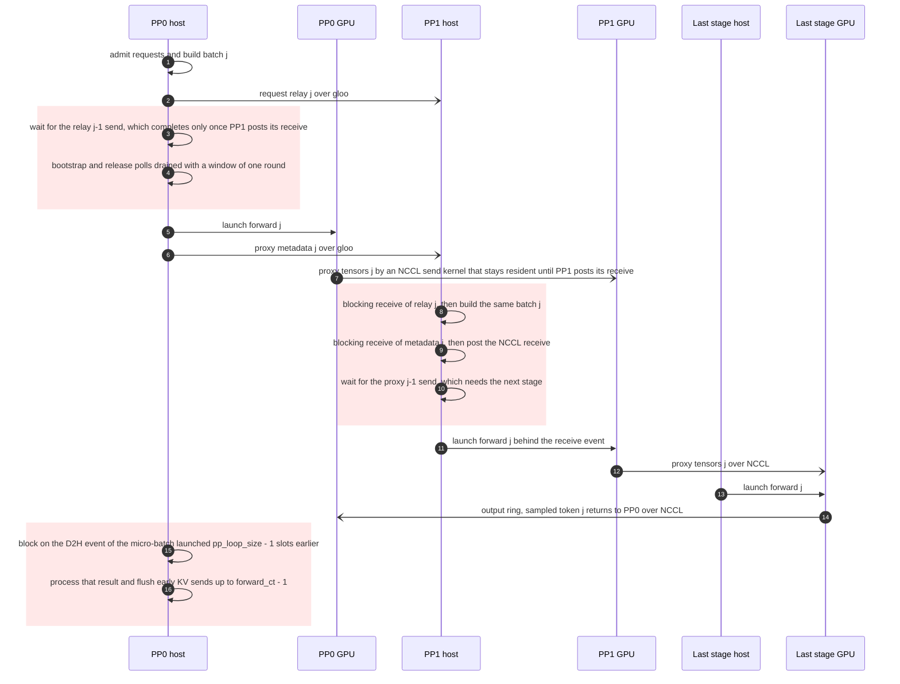
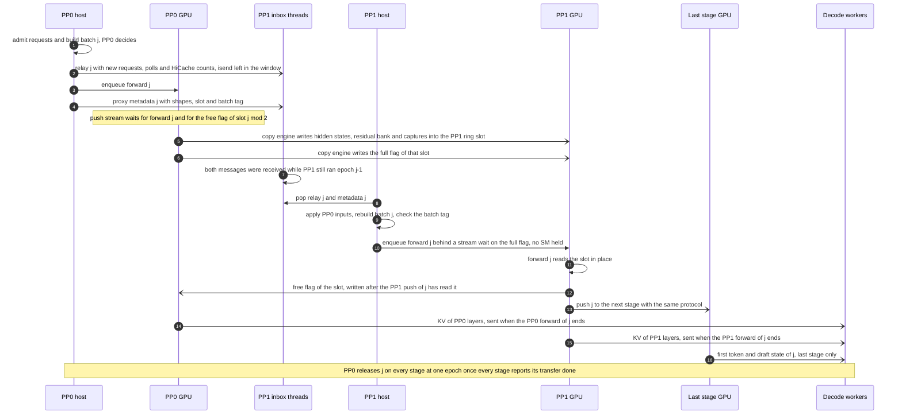
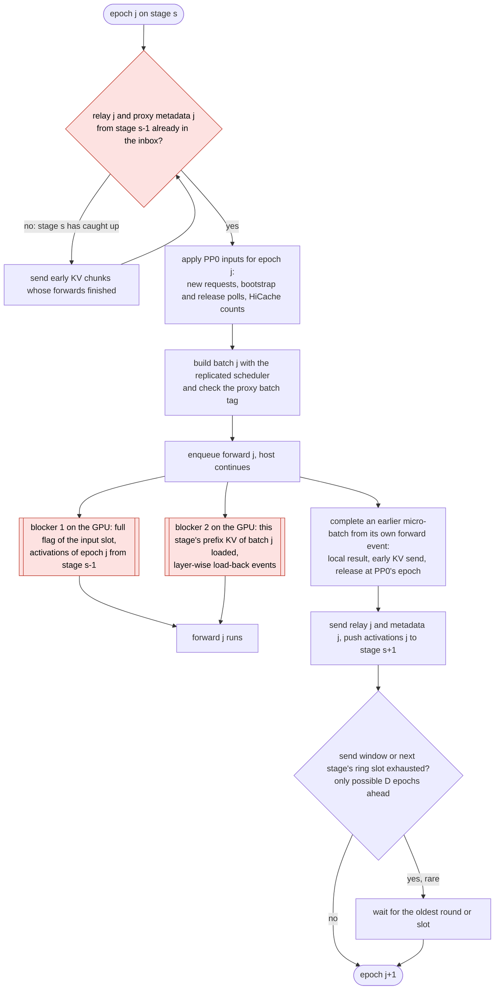
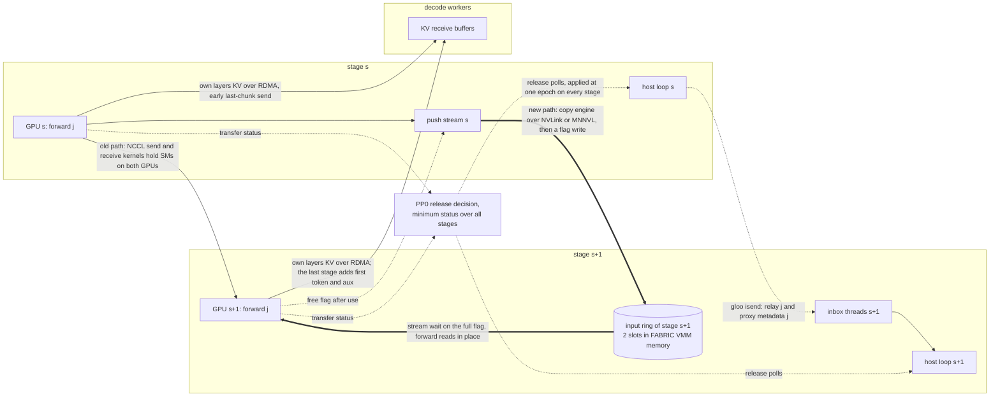
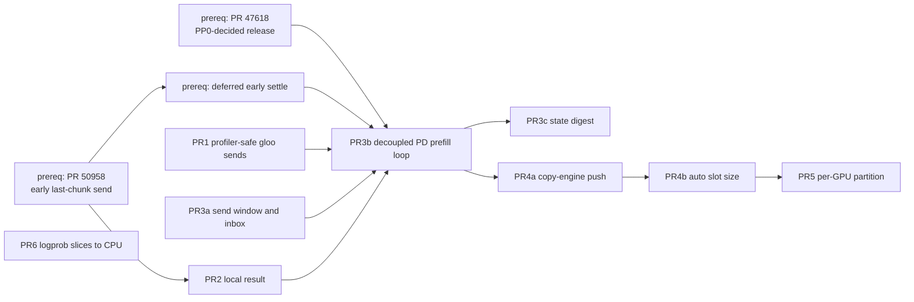

# Fully asynchronous PP prefill (AsyncPP)

| | |
|---|---|
| Status | Draft. Implemented and measured on a downstream branch; upstream PR series proposed in Section 9 |
| Scope | Pipeline-parallel (PP) prefill under prefill/decode disaggregation (PD), CUDA. The loop is `event_loop_pp_disagg_prefill` |
| Measured on | Kimi-K3.1-Pro, PP8 prefill worker (TP1 per stage) on 2 VR200 nodes with 4 GPUs each |
| Code | branch `k31-fullasync-pp` at `43de38801b`: 30 commits on base `a3e363ab58`, about 1,840 non-test and 800 test lines |
| Evidence tags | **[M]** measured, **[Mo]** modelled from measured inputs, **[code]** read from the code |

---

## 0. Summary

In lockstep PP prefill, every stage meets its neighbours on the host once per micro-batch. A stage waits for the next
stage to post its receives before it reuses a send buffer, PP0 waits for the last stage's sampled token to come back
around an output ring, and several control relays drain with a window of one round. The pipeline therefore beats at
the slowest of the eight micro-batches in flight plus the host rendezvous, not at the slowest stage.

AsyncPP removes every backward edge and the output ring from the compute path. The design has four parts:

- **Host decoupling (P1c).** Sends are left un-waited inside bounded windows, blocking receives run on background
  inbox threads, and each stage completes its own micro-batches ("local result").
- **Copy-engine push (P3).** Activations go into the next stage's input ring by copy engine, behind a 32-bit flag
  that the consumer's stream waits on. No NCCL kernel stays resident on either GPU.
- **Boot-time per-GPU layer split.** It rebalances stages for the measured speed of each power-capped GPU.
- **Correctness tooling.** A rank-invariant state digest, a per-proxy batch identity check and a byte-exact copy
  checksum.

Measured results:

- **P1c on two node pairs:** beat T −6.9% and −6.2%; new tokens per second through PP0 +8.1% and +7.1%. T over the
  slowest stage's forward (T/SOL_dec) goes from 1.056 to 1.004 and from 1.043 to 1.001 [M].
- **P3:** removes a 3–8% stretch of every waiting stage's forward, which resident NCCL P2P kernels cause by blocking
  the cooperative MoE routing kernel. On one pair the last stage's forward went from 189.0 to 152.2 ms, with 0 NCCL
  fallbacks. 21,000 pushed messages were byte-exact [M].
- **P3 plus the boot-time split, against the P1c serving configuration:** same nodes, 1200 s windows. T 188.4 → 181.2 ms
  (−3.8%) at KV floor 1.0 and 179.8 ms (−4.6%) at KV floor 0.94. PP0 new tok/s +4.2% and +4.7%. Prefix hit unchanged
  (0.9616 / 0.9614 / 0.9615). T/SOL_dec 1.005–1.009 [M].
- **Full serving run with P1c (640 concurrent agentic sessions), against the lockstep stack:**
  - throughput per GPU +0.9%, within noise;
  - per-user interactivity +5.3%;
  - TTFT p90 3.53 → 3.43 s;
  - total prefix hit 0.16–0.30 pt lower, which cancels the prefill gain. The cause is the release coupling in
    Section 5.6 [M].
- **What is left:**
  - about 6% to balanced speed of light (T/SOL_bal 1.055–1.061), from whole-layer granularity and the fixed work on
    PP0 and the last stage;
  - the cross-stage release coupling;
  - device-memory headroom, now the binding constraint.
- **Upstream:** 9 PRs plus 3 prerequisites already in flight. Our 9 PRs measure +1,816 / −71 non-test and
  +777 / −1 test lines on the branch (Section 9).

### 0.1 The one-line description, made precise

The short description is: "PP stages are no longer all synced by PP0; each decides for itself, with only two
blockers: (1) the previous stage's output; (2) whether the prefix KV has been loaded. PD KV transfer is not a blocker.
A fully automatic pipeline." Point by point:

| claim | precise statement |
|---|---|
| no longer synced by PP0 | **Correct for timing.** No stage waits for a later stage, and nothing goes around a ring. The waits that remain are forward edges from the predecessor and local waits on the stage's own GPU |
| each decides for itself | **Not yet.** PP0 is still the only decision maker. It admits requests and decides the bootstrap and release polls and the HiCache counts. These inputs travel downstream hop by hop on host channels, ahead of the activations, and every stage replays PP0's admission on them (a replicated scheduler). So every stage builds the same batch. The proxy carries a batch identity tag that turns any mismatch into a hard error. Relaying the batch itself (P2b) is planned |
| blocker 1: previous stage's output | **Correct.** It has a host half (the relay and proxy metadata for epoch j, received ahead by an inbox thread) and a device half (the input-ring flag for epoch j). Neither holds an SM, and both bind only when the stage has caught up with its predecessor |
| blocker 2: prefix KV loaded | **Correct, and local.** The forward waits on this stage's own layer-wise HiCache load-back events. Whether to load is PP0's decision, relayed with the other inputs |
| PD KV transfer is not a blocker | **Correct for compute.** Each stage sends its own layers' KV as soon as its own forward ends. **But release is coupled.** A request's KV slots are freed on every stage at the same epoch, once all 8 stages have finished sending, because slot indices are shared by the replicated allocators. That keeps more device KV pinned and costs 0.16–0.30 pt of total prefix hit (Section 5.6) |
| fully automatic | **Correct within credits.** Send windows and ring slots bind only when a stage runs D epochs ahead of its successor. HiCache L3 write-back acks are counted on PP0, applied by every stage at the same epoch, and published 4 steps late, which keeps them off the critical path. The binding constraint is now device-memory headroom, not synchronization |

---

## 1. Motivation and speed-of-light framing

### 1.1 Setup

- One PD prefill worker runs as 8 pipeline stages, TP1 each, on 2 VR200 nodes with 4 GPUs per node. The middle hop
  crosses nodes over multi-node NVLink (MNNVL).
- A micro-batch of about 16k new tokens (`--chunked-prefill-size 16384`) enters PP0 every beat and leaves the last
  stage eight forwards later. Each stage sends its own layers' KV to the decode workers (Mooncake).
- The model is a 93-layer hybrid:
  - linear-attention (KDA) layers, with full-attention (DSA) layers at 4, 8, …, 92 and 93;
  - an attention-residual bank of 12-layer blocks;
  - draft-model hidden-state captures at 6 layers (`dspark_hidden_states`).
- So the activation message between stages (the *proxy*) grows with depth: from 672 MiB after PP0 to 2,688 MiB
  after PP6 at 16,384 tokens.
- Test rig: one such prefill worker, a stub decode that receives KV, and a replayed agentic multi-turn request stream
  with 64 requests in flight. It warms up for 1,600 requests, then measures a 300 s or 1,200 s window. L3 storage is
  off.

### 1.2 Yardsticks

| symbol | definition |
|---|---|
| **T** | Beat: wall time between consecutive micro-batches at PP0 (window / batches) |
| **F_s** | GPU time of one forward on stage s, from CUDA events around the forward; E[F_s] is its mean over the window |
| **SOL_dec** = max_s E[F_s] | The best beat any schedule can reach without moving layers or GPUs |
| **SOL_bal** = mean_s E[F_s] | The best beat after perfect stage balancing |
| **E[max of 8]** | Lockstep yardstick: a lockstep beat waits for the slowest of the 8 micro-batches in flight, so T ≥ E[max_s F_s] even with zero host cost |

The honest F_s is the one measured *in the decoupled arm*. When the gaps between forwards close, the side work that
used to run in them overlaps the forward and stretches it: HiCache copies, activation traffic and KV pack kernels.
SOL_dec is computed from those F_s.

### 1.3 Where lockstep sits [M]

| run | T (ms) | SOL_dec | E[max of 8] | T/SOL_dec | T/SOL_bal |
|---|---|---|---|---|---|
| rig, lockstep (pair A) | 198.3 | 187.8 (PP0) | 192.6 | 1.056 | 1.170 |
| production-like serving, lockstep, worker 0 | 190.9 | 166.6 (PP5) | 187.2 | 1.146 | — |
| production-like serving, lockstep, worker 1 | 193.4 | 163.2 (PP4) | 179.1 | 1.185 | ≈1.27 |

- In serving, most of the gap is the **lockstep penalty** E[max of 8] − SOL_dec, which is 15.9–20.6 ms.
  - Serving micro-batches are uneven: p90/mean forward is 1.12–1.19 per stage (mixed prefixes, the per-batch request
    cap, chunk tails), against 1.06–1.10 on the rig.
  - In lockstep every beat waits for the slowest batch in flight.
- The rest, 3.7–14.3 ms, is host and relay stalls. The top three are the Mamba L3 tombstone wait, the release relay
  drain and the output-ring receive.
- A tandem-queue simulation on measured per-forward times puts two thirds of the rig's T − SOL_dec on the
  per-micro-batch host rendezvous and one third on running only 8 micro-batches in flight with no slack [Mo].
- Full decoupling is worth up to −16% on serving and balancing a further −7% [Mo].

### 1.4 Goal

1. **T → SOL_dec.** Remove every wait that is not a data dependency, so the slowest stage runs its forwards back to
   back.
2. **SOL_dec → SOL_bal.** Only after step 1 can moving layers or GPUs pay. In lockstep, a balanced split cut SOL_dec
   from 187.8 to 177.0 ms (−5.7%), yet the beat stayed at 195.6 ms (T/SOL_dec 1.105, on another node pair), because
   the lockstep penalty absorbed it [M].

Non-goals: the PP decode loop, the non-PD PP loop and NPU. The same ideas apply there, but they are not implemented.

---

## 2. Lockstep PP prefill (before)

### 2.1 Control flow of one micro-batch slot

The lockstep baseline is SGLang's PD prefill PP loop plus the comm-overlap stream and the early last-chunk send
(prerequisite #50958). The loop has `pp_loop_size = pp_size + pp_async_batch_depth` slots. In every slot, every stage
does the following:

1. Ingest. A stage after PP0 does a blocking gloo receive of the request relay from its predecessor: a host rendezvous
   with the upstream stage on every micro-batch.
2. It waits for its own previous request send to complete. A gloo send completes only when the receiver posts its
   receive.
3. Bootstrap, transferred and release consensus: `PPConsensusStore` plus `pp_sync_polls`, drained with a window of 1.
4. It builds the batch. Every stage runs the same scheduler on the same relayed inputs.
5. It receives the proxy: a blocking gloo receive of the metadata, then an NCCL receive of the tensors on the comm
   stream. This is a second host rendezvous with the upstream stage.
6. It waits for the previous proxy's NCCL send. That send completes only after the downstream stage reaches its own
   step 5: a rendezvous with the downstream stage.
7. It launches the forward.
8. Output ring: PP0 blocks on the D2H event of the micro-batch launched `pp_loop_size − 1` slots earlier, whose
   sampled token travelled back from the last stage.
9. Release relay.
10. Async sends of requests and activations to the next stage.

Each stage meets both neighbours once per micro-batch, and at most 8 micro-batches are in flight, one per stage, with
no slack.

### 2.2 Sequence of one micro-batch, three stages (lockstep)



### 2.3 Every per-iteration synchronization

Edge types:
- **F**: forward data dependency.
- **B**: backward edge (stage s waits for s+1). This is what creates lockstep.
- **R**: ring edge (PP0 waits for the last stage).
- **L**: the host waits for its own GPU.
- **D**: device-only stream ordering.
- **C**: a credit.

S1–S19 are the per-iteration synchronizations on the PD prefill path. S20–S25 are stream-ordering and cleanup items
found during the audit. The six window-1 reverse edges that made the loop lockstep are **S2, S3, S4, S11, S12 and
S13**.

| id | sync point | why it existed | edge | lockstep cost | in AsyncPP |
|---|---|---|---|---|---|
| S1 | request relay receive on PP>0 (`point_to_point_pyobj`) | learn which requests PP0 admitted at epoch j | F, blocking | with S10: 1–23 s per minute on non-first stages [M] | inbox thread receives ahead; blocks only when the stage has caught up |
| **S2** | wait on the previous request send | buffer reuse; a gloo send completes only on the peer's receive | **B** | part of the host rendezvous (2/3 of T − SOL_dec [Mo]) | window of `pp_size + depth` rounds |
| **S3** | bootstrap polls relay, window 1 | all replicas move the same requests out of bootstrap at the same epoch | **B** + F | — | windowed send (main has this since #50481); receive through the relay inbox |
| **S4** | HiCache relay sends drained with window 1 | buffer reuse | **B** | — | windowed (main has this since #46363) |
| S5 | HiCache ready/write/load counts relay (`_pp_sync`) | every radix-tree replica applies PP0's counts | F | — | kept; one epoch message planned (P2) |
| S6 | host waits on its own write-back or L3 ack copy (`finish_event.synchronize`) | apply an ack only after this rank's copy finished | L | L3 storage acks: later stages blocked 174–870 ms per minute [M] | L3 acks published 4 steps late: 0.4–7.8 ms per minute [M]. Device write-back acks: same lag planned; their wait (1.3–2.5 s per minute) is hidden behind the GPU on the bottleneck stage (Section 6.3) |
| S7 | `writing_check` before device eviction | do not free KV that a D2H backup still reads | L | — | kept (per-stage memory safety) |
| S8 | Mamba L3 tombstone wait | tombstone written before slot reuse | L | top host wait in serving [M] | asynchronous tombstone |
| S9 | L3 prefetch decision relay | PP>0 takes PP0's prefetch decision | F | — | kept; P2 |
| S10 | proxy receive: gloo metadata, then a resident NCCL receive kernel | the activation data dependency | F, plus an incidental handshake | resident kernel stretches the forward 4–8% once the gaps close [M] | metadata received by the inbox thread; data by copy-engine push, with no kernel |
| **S11** | wait on the previous proxy send | buffer lifetime; the NCCL send completes only after the peer posts its receive | **B** | rendezvous with s+1 | tensor window of 2 rounds; under P3 a ring-slot credit checked by the push stream, not the host |
| **S12** | output ring | PP0 completes a micro-batch only when the last stage's token returns | **R** + B | D2H wait of 20–42 s per minute on every stage [M] | local result: each stage completes its own micro-batch |
| **S13** | release polls relay, window 1 | all replicas release the same requests at the same epoch | **B** + F | among the top host waits in serving [M] | windowed; PP0 decides (prerequisite #47618) |
| S14 | `d2h_event.synchronize()` at slot reuse | the host must hold the result before freeing the batch's KV, Mamba state and rows | R → L | part of S12 | the micro-batch's own forward event, already complete in steady state |
| S15 | early-send flush up to `forward_ct − 1` | last chunk sent only after the previous forward | L | 23% of the last stage's host time inside its forward interval at depth 2 [M] | waits only for the processed micro-batch's own forward; the rest is flushed while waiting for input |
| S16 | forward stream waits on the proxy receive event | the activation must land before use | F (device) | — | `cuStreamWaitValue32` on the slot's full flag |
| S17 | KDA first-call host sync, DSA indexer host prep | host prep inside the forward issue | L | — | KDA `cu_seqlens` seeded from the host |
| S18 | GC on the scheduler thread | stop-the-world collection | L | gen-2 GC of 1.1–1.3 s every 15–16 s on the last stage; 19–24 ms of the ~40 ms extra gap per iteration [M] | freeze after warm-up |
| S19 | settle of early-sent chunks | checkpoint frees must not race this stage's transfer | L | — | frees deferred to transfer completion (prerequisite) |
| S20 | `forward_stream.wait_stream(schedule_stream)` | inputs copied H2D on the schedule stream | D | — | kept; narrowing to the batch's own H2D event planned |
| S21 | CUDA-graph send-done event | graph outputs are static buffers | D | not on the eager prefill path | — |
| S22 | send-window payload lifetime | payload alive until NCCL stops reading | C + D | — | push sources: `record_stream` on the push stream. The NCCL fallback relies on NCCL's `recordStream`, still to be verified for this torch build |
| S23 | write-after-read barrier for HiCache write-back | copy KV only after the forward that wrote it | D | — | fixed on main (#49310) |
| S24 | relays on idle iterations | relays are per iteration, not per micro-batch | B / F | — | P2: one message per epoch |
| S25 | PP0's output inbox thread | channel of the removed ring | — | — | cleanup |

### 2.4 Measured cost on the rig (lockstep, pair A, 300 s) [M]

| stage | E[F] ms | GPU busy | gap before forward: host late / waiting on dependency (ms per forward) |
|---|---|---|---|
| PP0 | 187.8 | 94.7% | 11.2 / 0.0 |
| PP1 | 172.4 | 86.9% | 11.5 / 15.1 |
| PP2 | 174.4 | 87.9% | 9.1 / 15.5 |
| PP3 | 167.4 | 84.3% | 8.7 / 22.8 |
| PP4 | 174.9 | 88.0% | 7.9 / 16.2 |
| PP5 | 172.2 | 86.6% | 7.6 / 19.2 |
| PP6 | 149.7 | 75.3% | 7.2 / 42.0 |
| PP7 | 157.4 | 79.1% | 7.9 / 33.6 |

- T = 198.3 ms, SOL_dec 187.8, SOL_bal 169.5.
- Every stage spends 20–42 s per minute in the output-ring D2H wait.
- The non-first stages spend another 1–23 s per minute waiting for the upstream host.
- Even the bottleneck stage (PP0) loses 11.2 ms per forward to host lateness.

---

## 3. Problems we hit

### 3.1 Host D2H and host-wait syncs

- **S14 (output ring).** The largest single wait on every stage. Local result removes the ring; what remains is a wait
  on the micro-batch's own forward event, which has completed by the time the slot comes round.
- **S15 (early-send flush).** It waited for every forward up to `forward_ct − 1`. Once the host runs ahead of its GPU,
  that is the forward just launched, which blocks the host for a whole forward.
- **S6 (ack syncs).** With L3 on, later stages blocked in the ack drain for 174–870 ms per minute until PP0 published
  storage acks with a lag (Section 5.7).
- **S17 and S18** (KDA first call, GC). These were removed before this work. They matter because a stall shorter than
  one forward is absorbed by a decoupled stage and is not absorbed by a lockstep one.

### 3.2 Release sync

The release of transferred requests had a ring and a window-1 drain:
- a two-pass consensus from the last stage back to PP0 (S13 plus a ring edge);
- a per-iteration relay drained with a window of one round.

Upstream #47618 replaces the ring with a PP0 decision. AsyncPP windows the relay. The release itself stays
coupled across stages (Section 5.6).

### 3.3 Resident NCCL P2P kernels stretch the waiting side

Decoupling closed the gaps between forwards, and the last stage's forward grew from 157 to 184 ms on pair A.

A 10-step CUPTI trace shows the cause [M]:
- The compute stream idles between the MoE routing kernels `routingInitExpertCounts` and `routingIndicesCoopKernel`,
  while the only kernel on the GPU is an NCCL SendRecv.
- The idle time is 45 ms per forward on the last stage, 28 on PP0 and 22 on PP4.
- The routing kernel is a cooperative launch: it needs every SM free at once. An NCCL P2P kernel that waits on the GPU
  for its peer holds SMs.
- In lockstep these kernels ran in the gaps between forwards, so the effect never showed.

A two-process microbench with a cooperative grid-sync kernel in a synthetic forward reproduces it [M]:

| waiting side | forward alone (ms) | NCCL P2P | copy-engine push |
|---|---|---|---|
| producer waits (consumer is the bottleneck), one node | 194.7 / 198.8 | 205.4–207.4 (+4–6%) | 198.4 / 199.4 |
| consumer waits (producer is the bottleneck), one node | 184.2 / 188.6 | 197.3–199.2 (+6–7%) | 179.6 / 182.4; 17–19 ms idle waiting for input, forward untouched |
| producer waits, two nodes (MNNVL) | 194.5 | 209.5 (+7.7%) | 192.8 / 195.4 |
| consumer waits, two nodes | 190.2 | 196.0 | 182.5 / 186.4; 9–10 ms idle waiting for input |

Every NCCL P2P has one side spinning. Posting the receive later only moves the spin to the sender: we tried this as
`SGLANG_PP_DECOUPLE_LATE_RECV` and do not propose it.

Without a cooperative kernel the same bench shows NCCL costing only 0.3–0.8% and the push 0.0% [M]. Whether a model
has cooperative kernels decides how much P3 is worth.

### 3.4 Hangs and an OOM on the way

| # | where | symptom | root cause | fix | regression coverage |
|---|---|---|---|---|---|
| 1 | first decoupled control rounds | a stage blocks forever in a send wait | a gloo send `Work` waited twice: a second `wait()` never returns | each send is waited exactly once, by the window that owns it | `TestPPSendWindow` |
| 2 | P1 with the host window also applied to proxies | OOM in the DSA indexer 48 s into warm-up (4.25 GiB needed, 3.96 GiB free) | each un-waited proxy round pins its tensors, about 0.47 GB at 16k tokens; a window of 10 pinned about 4.2 GB more | separate tensor window, default 2 (`320c3d337d`); every buffer change now gets a memory check before it runs on a GPU | — |
| 3 | first profiler fix | deadlock at profiler stop | the stop ran inside `run_batch`, before this iteration's relay was sent, and the next stage consumes the earlier sends only after that relay | the decoupled stage runs the profiler predicate at the micro-batch boundary (`364eee0806`) | `TestHostSendsBeforeProfilerStop`; profiler cascades 4/4 clean [M] |
| 4 | P3, first output message mid-run | the message never arrives | NCCL builds a ring pair's P2P communicator lazily, on the first send, and both ranks must join. With activations on the copy engine, that first send is mid-run, and its receiver is blocked behind the sender's own pushes | create every ring pair's communicator at setup, even ranks sending first (`0c62448f7f`) | small-model rig repro; **no unit test yet** |
| 5 | P3 | a stage stalls inside `event.synchronize()` in the proxy window | the host waited on a push; the push waits for the next stage's slot release, which needs this stage's next relay, sent only after the window wait | a push's `wait()` orders the caller's stream, like an NCCL `Work` (`8677a0462b`) | small-model rig repro; **no unit test yet** |
| 6 | P3, a proxy too large for the slot | one stage idle in `_wait_oldest`; the next stage's receive thread already waits for the following message | the NCCL fallback's gloo metadata sends were waited twice: once by the slot release, once by the window | the release fences only device-memory sends (`cf14e21473`) | `test_a_fallback_send_after_a_pushed_input_waits_each_gloo_send_once`: fails on the old code (2 waits per send) and passes with the fix |

On hang 6: the proxy grows with depth, so for a band of batch sizes a stage's input fits its slot while its output
does not. A slot-size model predicted the hanging stage in every case [M]:
- PP5 at 12,288 tokens with 1,600 MiB slots: three runs;
- PP4 at 16,384 tokens: one run;
- PP6 on a 16-layer test model with 1,000 MiB slots.

### 3.5 Torch-profiler use-after-free

Symptoms [M]:
- Decoupled runs crashed 13 times in 16 after a profiler capture.
- The crashes looked like pipeline bugs. A proxy arrived for the wrong micro-batch, a gather went out of bounds,
  16,346 rows arrived for a 16,384-token batch, and two int64 token ids held monotonic-clock-like values.
- One run segfaulted inside `gc.collect`. A scheduling divergence cannot corrupt a Python object, so this pointed to
  host heap corruption.
- Order traces of every sort input on every stage showed no scheduling drift.

Mechanism [M, probe]:
- A gloo `Work` started while the torch profiler runs opens an async RecordFunction. Its end callback runs at `wait()`.
- A send window keeps up to `pp_size + depth` rounds un-waited, so dozens of Works start before `stop()` and are waited
  after it.
- Each late end callback writes into event storage that `stop()` has already freed.
- A two-rank probe in the serving image (torch 2.15) reproduces it:

  | when the Works are waited | runs | result |
  |---|---|---|
  | after `stop()` | 5 | segfault in GC, 5/5 |
  | after `stop()`, with canaries placed right after it | 2 | one segfault, one glibc abort |
  | before `stop()` | 3 | clean, 3/3 |
  | no profiler | 2 | clean, 2/2 |

- Lockstep keeps a window of 1, so few Works span a stop: 13 lockstep profiler arms were clean.

Fix:
- Async CPU-group sends issued on the scheduler thread while a profiler runs are tracked (`host_send`).
- Before either profiler stops, each tracked send that has not completed is waited once and replaced by a
  waited marker, because a second wait would block.
- A decoupled stage evaluates the profiler step predicate at the end of its micro-batch iteration, after every send of
  that iteration went out (Section 3.4, hang 3).
- Result: 4/4 profiler cascades clean, and one of them ran its full 300 s window with 5,562 requests completed and 0
  failed [M].

Exposure on main: main now keeps `pp_size + depth` rounds of gloo sends un-waited on the HiCache PP-sync channel
(#46363) and on the PD poll and grammar channels (#50481). A torch profiler stopped during PP serving on main is
therefore likely exposed [inferred; not yet reproduced on main].

---

## 4. Design principles

### 4.1 Two dependencies, credits, nothing else

A stage needs exactly two things from the rest of the system to run micro-batch (epoch) j:

- **E1, activation hand-off.** The predecessor's output activations of epoch j: hidden states, the residual or
  attention-residual bank, and draft captures. This is the model's own data dependency. AsyncPP makes it a
  device-only dependency: a copy-engine write into a ring slot, and a stream wait on a flag.
- **E2, per-epoch control.** Every stage runs a replica of PP0's scheduler (same batches, same KV and Mamba slots, same
  radix tree), so it needs PP0's inputs for epoch j: arrivals, bootstrap and transfer polls, HiCache counts and
  decisions. They are delivered hop by hop as ordered host messages, received ahead by a background thread. They
  block a stage only when it has caught up with its predecessor, which means it had nothing to do.

Bounded resources are **credits**, not synchronization:
- an input-ring slot;
- a window of un-waited sends.

A credit binds only when a stage is at least D epochs ahead of its consumer. Sized at the measured peak plus one, it
never binds in steady state.

Everything else in the lockstep loop was incidental: backward edges, the ring edge, host waits on the own GPU where
the host does not read the result, and relays on idle iterations.

### 4.2 The replication invariant

Every input that changes a stage's replicated scheduler or cache state carries the epoch at which it takes effect,
assigned by PP0. Each stage applies exactly the epoch-k items while running epoch k, and blocks if they have not
arrived. Nothing a stage observes locally may change replicated state except through such an item: a copy finishing,
a transfer completing, a thread draining a socket, a GC.

Under the invariant no stage's timing can change another stage's state, so stages can run independently. Lockstep hid
violations because all stages reached epoch k within one beat of each other.

A second invariant covers admission policy. Every piece of admission-policy state must be a pure function of
replicated, epoch-tagged inputs:
- the prefix-refresh cursor and the matched-at stamps;
- the pass counters behind aging promotion;
- the tie-break keys.

The three early returns in front of the priority pass read only replicated state today. Any new gate must do the same.

The audit of every consumption point is in the design notes. One example of a violation found and fixed on the way:
the early-send path decided whether to skip a request's checkpoint from this stage's own transfer status. That is
local state, so stages could diverge. The fix decides from early-send membership, which is replicated.

### 4.3 Alternatives that did not work [M]

- **More micro-batches in flight without removing the rendezvous** (`--pp-async-batch-depth 2`): T went from 216.2 to
  217.2 ms. The time the last stage used to spend waiting moved inside its forward interval.
- **Posting the NCCL receive late:** it moves the resident kernel from the receiver to the sender (Section 3.3).
- **Balancing in lockstep:** see Section 1.4.

---

## 5. Design, component by component

### 5.1 Decoupled per-stage host loop (`SGLANG_PP_DECOUPLE_HOST`)

- **Send windows.** One `PPSendWindow` per send channel: requests, proxy, output, transfer, release.
  - A round's works stay un-waited until the round falls `bound` rounds behind. The default bound is
    `pp_size + pp_async_batch_depth`.
  - The window then waits each work of that round exactly once and drops the payload.
  - A CUDA-graph forward's proxy still waits at once, because the next replay overwrites its static output buffer.
- **Receive inboxes.** `PPRecvInbox` runs the blocking receive of one host channel back to back on a daemon thread, up
  to `depth` messages ahead.
  - A thread is needed because a gloo `irecv` cannot be polled: `is_completed()` stays False until `wait()`, and a
    `wait(timeout)` tears down the group.
  - Gloo matches receives in posting order, so every receive on a channel goes through the inbox.
  - A failure on the thread re-raises at the next `pop()`.
  - Two inboxes per stage: the request relay, which also carries the transfer and release rids, and the
    proxy/output dict channel. The dict channel's thread takes only the CPU half of `recv_tensor_dict`, through the new
    `recv_tensor_dict_host_part`. Device tensors are received or mapped by the loop thread.
- **Early-send flush (S15).** It waits only for the processed micro-batch's own forward. While the next input is still
  upstream (the inbox is empty), the loop sends the early KV chunks whose forwards have finished.
- **Profiler at the boundary.** The step predicate runs at the end of the micro-batch iteration (Section 3.5).
- **Liveness counters.** Logged every interval: window peaks per channel, inbox pops that found their message
  already received, CE push stats, and free memory and its minimum.
  - Rig readings with the serving configuration: request window peak 9 rounds, proxy 3, output 2 [M].
  - Stage lag is about 190 ms per hop. One stage ran up to 459 ms ahead of its successor inside its credits [M].

### 5.2 One micro-batch through the new loop



### 5.3 Each stage's event loop and its two blockers



The host-side wait at the top and blocker 1 are the two halves of "the previous stage's output". Blocker 2 is local.
The credit check at the bottom is not a synchronization: it binds only when the stage is D epochs ahead.

### 5.4 Asynchronous batch-metadata relay

What PP0 relays per epoch: new requests, bootstrap polls, transfer and release polls, HiCache ready/write/load counts,
and L3 prefetch decisions.

How it stays correct:
- The relay channels are FIFO, and each loop iteration consumes exactly one message per channel.
- So every stage sees the same inputs in the same epoch order, whatever its wall-clock pace. Only the time at which a
  stage reaches epoch j changes.

Checks:
- **Proxy batch tag** (`SGLANG_PP_CHECK_PROXY_BATCH`). Each proxy carries (request count, new tokens, a hash of the rids
  in order). The receiving stage asserts that it matches the batch it is about to run. It is cheap and stays on in
  serving.
- **Rank-invariant state digest** (`SGLANG_DEBUG_PP_STATE_DIGEST_EVERY`). Logged per stage at equal epochs. It has
  three parts:
  - batches: a rolling hash of (rid, prefix length, extend length) of every batch built;
  - slots: the request-to-slot map of every live request;
  - device: free-page order and tree values. This part is informational, because it legitimately differs across
    stages once HiCache write-back runs, in lockstep too.

  Reports are grouped by epoch, not by log order.

Planned:
- **P2:** one ordered `EpochControl` record per epoch replaces the five relays.
- **P2b:** the record carries the batch composition and PP0's cache-operation log, so downstream stages stop
  re-running admission. That removes their host admission cost and the requirement that eight replicas stay
  bit-identical under timing perturbations.

### 5.5 Proxy send window (`SGLANG_PP_DECOUPLE_TENSOR_WINDOW`, default 2)

- A proxy round holds hidden plus residual, 2 × 16,384 × 7,168 × 2 B = 0.47 GB at 16k tokens, until it is waited.
- The tight stages had 46.8 GB free after the KV pools, but a single DSA indexer allocation needs 4.25 GiB. The
  host-relay window of 10 rounds pinned about 4.2 GB more per stage and OOMed (Section 3.4, hang 2).
- Two rounds allow one round of slack over lockstep for at most 0.47 GB per stage.
- With CE push the window holds `_Push` entries. Their sources stay alive through `record_stream` on the push stream.

### 5.6 Copy-engine push, P3 (`SGLANG_PP_CE_PUSH`)

**Memory.**
- Each stage after the first owns an input ring of D = 2 fixed-size slots and a `full[D]` flag array, both allocated
  with `cuMemCreate(..., CU_MEM_HANDLE_TYPE_FABRIC)`.
- Each stage before the last owns a `free[D]` flag array.
- The arrays are exported once at setup to the neighbour that needs them and mapped there. Inside an NVLink domain
  this works across nodes.

**Protocol for micro-batch `seq` in slot `seq mod D`.**

```text
producer (stage s), on its push stream:
    wait for forward seq's launch event
    cuStreamWaitValue32(free[slot] >= seq - D + 1)          # credit: the slot's previous user released it
    for each tensor of the proxy (hidden, residual or bank, captures):
        cuMemcpyDtoDAsync(peer_ring + slot * slot_bytes + offset, tensor)    # copy engine, NVLink or MNNVL
    write seq + 1 into a local word, then cuMemcpyDtoDAsync it to peer full[slot]   # flag after the data
    isend over gloo: (dtype, shape, offset) per tensor, (slot, seq), batch tag

consumer (stage s+1):
    pop the metadata from the inbox (normally already received)
    cuStreamWaitValue32(forward stream, full[slot] >= seq + 1)        # no SM held while waiting
    run the forward on views of the slot (no copy out of the ring)
    after this stage's own push of seq is enqueued (it may read the slot in place, e.g. an in-place residual):
        write seq + 1 to the producer's free[slot] (copy engine on the push stream; the last stage uses its forward stream)
```

Notes:
- **Cross-node flags.** Stream memory operations cannot target memory imported from another node: they return
  `CUDA_ERROR_INVALID_VALUE` across MNNVL. So a flag is written to a local word and copied by the copy engine, in
  stream order after the data copies.
- **No host waits.** A push's `wait()` only orders the caller's stream on the push's done event (hang 5).
- **Fallback.** A message larger than the next stage's slot, or a non-contiguous tensor, goes over NCCL as before and
  is counted. Releasing a slot behind a fallback fences only the device-memory sends, which are the NCCL sends that
  may read the slot. The gloo metadata sends stay in the window, which waits each of them once (hang 6).
- **Setup.** Setup is collective over the PP group and runs before any inbox thread starts.
  - If FABRIC allocation or mapping fails on any stage, every stage keeps NCCL (all-ranks agreement).
  - Every ring pair's NCCL communicator is created at setup (hang 4).
- **Per-stage slot sizing.** The proxy a stage ending at layer `end` sends is
  `tokens × hidden × itemsize × (1 + ceil(end / 12) + captures below end − 1)` for this model.
  `SGLANG_PP_CE_PUSH_SLOT_MB` takes one size for all stages, one per receiving stage, or `auto` (the model reports its
  proxy bytes per token, the stages all-gather them, plus 2 MiB). At 16,384 tokens with the 12,12,12,12,12,12,11,10
  split:

  | receiving stage | PP1 | PP2 | PP3 | PP4 | PP5 | PP6 | PP7 |
  |---|---|---|---|---|---|---|---|
  | slot MiB | 673 | 897 | 1,345 | 1,569 | 2,017 | 2,465 | 2,689 |
  | ring (2 slots) GiB | 1.31 | 1.75 | 2.63 | 3.06 | 3.94 | 4.81 | 5.25 |

  A uniform 1,600 MiB slot (3.125 GiB per ring) sent PP4–PP6's proxies over NCCL, which left those stages with
  exactly the resident kernels P3 is meant to remove.
- **Cost of the copy.** Mean push time is 0.7–3.3 ms per message, growing with depth. There were 0 fallbacks on every
  stage over 52–54 one-minute intervals [M].
- **Requirements.** The comm-overlap stream (`SGLANG_PP_COMM_OVERLAP`, on main), attention TP 1 per stage, and FABRIC
  handles (an NVLink domain with IMEX). TP>1 stages and non-FABRIC systems fall back to NCCL.
- **Debug copy check** (`SGLANG_DEBUG_PP_CE_CHECKSUM=N`). Each side sums the int32 view of every tensor of its first N
  sent or received messages on the GPU and writes the sums once. Sender PPk and receiver PPk+1 are compared message
  by message.

### 5.7 PD transfer and release semantics

- **Early last-chunk send** (prerequisite #50958). Each stage sends its last KV chunk when its own forward of that
  chunk ends, not after the last stage's result comes back. Decode receives every stage's layers directly.
- **Local result** (`SGLANG_PP_PD_LOCAL_RESULT`). The output ring is skipped for a PD prefill batch whose results feed
  nothing on earlier stages: extend mode, no logprobs, no grammar, no sampling mask, no routed experts.
  - The last stage processes its own output and alone sends the first token and draft state (aux) to decode. It keeps
    a copy of its outputs, because a later draft CUDA-graph replay reuses the buffers.
  - Earlier stages process a host-side placeholder once their own forward event has fired, so reading it never waits
    on the device. They send no aux.
  - The worker-level gate: Mooncake transfer backend, not NPU, no speculative relay, no sampling observer. Other
    batches use the ring as before.
- **Deferred early settle** (prerequisite). An early-sent request's checkpoint frees are held until its transfer
  ends. The decision follows early-send membership, which is replicated, not this stage's transfer status, which is
  local.
- **Release.**
  - PP0 polls each request's transfer status as the minimum over all PP stages. The stages' statuses reach PP0 through
    `PPConsensusStore`, then a MIN reduction runs over attention TP and CP.
  - PP0 relays (rids, polls) on the release channel. Every stage asserts that its transfer queue equals PP0's and frees
    the same requests at that epoch.
  - The relay is windowed, so the release does not block compute.
- **Why release stays coupled.** Request slots and KV page indices are produced by replicated allocators and are the
  same on every stage. If a stage freed a request's pages when its own send finished, its allocator would diverge
  from the others' at the next admission. So a request's KV is pinned on all 8 stages until the slowest stage has
  sent.
- **What the coupling costs** [M]. Full serving run with P1c against the lockstep stack, 640 sessions, three
  windows; different node allocations:

  | | lockstep | P1c |
  |---|---|---|
  | requests waiting for KV transfer, per worker | 4.4–5.7 | 12–14 |
  | PP0 device KV use (mean) | 0.42–0.48 | 0.55–0.61 |
  | transfer queue wait p50 | ~125 ms | ~310 ms |
  | send time p90 | 232–246 ms | 335–350 ms |
  | total prefix hit per window (sum of the tier shares, incl. L3) | 0.9450 / 0.9448 / 0.9458 | 0.9425 / 0.9432 / 0.9429 (−0.25 / −0.16 / −0.29 pt) |
  | device-tier share of hits | 0.0579 / 0.0504 / 0.0515 | 0.0418 / 0.0474 / 0.0434 |
  | host-tier share of hits | 0.8681 / 0.8704 / 0.8731 | 0.8826 / 0.8726 / 0.8785 |

  - Decoupled prefill runs ahead, so more requests hold device KV while queued for transfer, and less device memory is
    left for cached prefixes.
  - The device tier loses 0.30–1.61 pt. The host tier recovers 0.22–1.45 pt of it, and the net is −0.16 to −0.30 pt.
  - The queue itself is the 4 serial transfer workers per stage with head-of-line blocking. Each is about 70% busy with
    a heavy send-time tail. RDMA (0.4 GB/s used) and decode are not the limit.

### 5.8 HiCache load-back and the ack lag

- **Load-back (blocker 2).** Each stage loads the host-cached prefix KV of its own layers. The forward stream waits
  layer by layer on the load events (`LayerDoneCounter.wait_until`), on the device. Which nodes to load is a
  replicated decision. The load-completion count is PP0's and is relayed (S5).
- **Write-back and L3 acks.** Ack counts are PP0's and are relayed. Every stage applies the same count at the same
  epoch, and a stage whose own copy has not finished waits for it at that point (S6).
  - For L3 storage acks, PP0 publishes the cumulative ready count from D steps earlier
    (`SGLANG_HICACHE_L3_ACK_LAG_STEPS`, 4 in serving). Later stages, which issued the same puts at the same epoch,
    then rarely block. Blocking fell from 174–870 to 0.4–7.8 ms per minute [M].
  - For device write-back acks the same lag is planned. Their remaining host wait is hidden on the bottleneck stage
    (Section 6.3).
  - The L3 storage stack and its ack lag are not on main and are not part of this PR series.

### 5.9 Boot-time per-GPU partition (`SGLANG_PP_PARTITION_AUTO`)

> **Status (2026-11-22): under rework, see PR 9/9 ([#52199](https://github.com/sgl-project/sglang/pull/52199), back in
> draft).** In production serving on 2026-11-22, the automatic split moved the bottleneck off stage 0. Work then queued
> inside a deeper pipeline, and throughput fell by about 3.5%. The measurements in this section and in rows R5 and R6
> of Section 7 were taken on 2026-11-21 and are kept as measured.

**Why.**
- After P3, a stage's forward time depends on the physical GPU it runs on, by more than whole-layer balancing can
  recover.
- All GPUs ran under the software power cap (throttle reason 0x4, 2.0–2.2 kW), with mean SM clocks of 1,832–2,019 MHz.
  Forward time follows the SM clock about 1:1 (slope 1.03, r = 0.87 over 12 GPUs).
- Fitted per-GPU factors were 0.96–1.05 [M].
- Swapping GPU pairs moved the slow stage with the GPU, not with the stage index.
- On one pair, P3 plus a static rebalanced split gained nothing, because the beat moved onto the two lowest-clocked
  GPUs (1,795 and 1,805 MHz) [M].

**What runs at boot**, before the weights load, on every rank:

1. **Measure.** All GPUs start at once after a barrier and run a 20 s burn. One burn unit is 4 bf16 GEMMs of
   16384×7168 × 7168×4096 plus a 1 GiB copy, and the measure is the mean time per unit over the second half. A fixed
   speed list can replace the burn for tests.
   - A stretch factor maps the burn's spread to the serving spread (×1.25 here).
   - The burn's factors correlate with the serving-fitted factors at r = 0.87–0.93 on two pairs.
   - Two boots on the same nodes agreed within 0.012.
2. **Agree on inputs.** All-gather (pp_rank, speed, total memory). A stage's speed is its slowest rank's.
3. **Search.** Every rank runs the same deterministic dynamic program: the contiguous split that minimizes
   max_s cost_s × factor_s, with ties broken on the running max and then the prefix. Constraints per stage:
   - at least one full-attention layer, and in a hybrid model at least one linear-attention layer. A stage without
     either kind gets an empty KV or Mamba pool, which the HiCache host split rejects at boot;
   - KV token capacity at least `KV_FLOOR` × the reference split's. Capacity is the minimum across stages, so this
     bounds what balancing may cost in cache size;
   - headroom outside the static pools for its input ring (2 slots of the predecessor's proxy), its in-flight sends,
     the DSA indexer-logits budget and a margin;
   - at most 16 layers.
4. **Agree on the result.** Rank 0 broadcasts its split; every rank asserts it computed the same and stops otherwise.
   `SGLANG_PP_LAYER_PARTITION` is set before the model builds. `SLOT_MB=auto` sizes the CE rings from the new end
   layers.

**Cost model.** Per-layer cost by type at the reference batch (here DSA 27.4 ms and KDA 10.4 ms at 16k tokens,
first-stage +5.5 ms and last-stage −16.9 ms), with weight, state and KV bytes per layer type. It is a built-in
constant for this model, or JSON (`SGLANG_PP_PARTITION_AUTO_MODEL`).

**Expected gain** [Mo]:
- Over three node pairs, the best split under each pair's GPU factors beats the static rebalanced split by +4.7%,
  +4.2% and +6.3%. A residual bootstrap gives p10 / p50 / p90 = 4.1 / 4.8 / 5.4%.
- In a CPU cache replay, a device pool at 94% costs 0.010–0.019 pt of hit, because 98–99% of the lost device hits come
  back from host memory.

**Measured:** Section 7, rows R5 and R6.

### 5.10 Timelines: lockstep, P1c and P3 with the per-GPU split

The chart below shows four of the eight stages, two beats each. Bars are the measured mean forward times per stage;
gaps are idle GPU. Rows marked critical are the stages that set the beat. The first two panels are the same nodes
(pair A). The last two panels are another pair (pair E), whose P1c baseline beat was 188.4 ms.

```mermaid
---
displayMode: compact
---
gantt
    title Steady state, 4 of 8 stages, 2 beats, measured mean forwards in ms
    dateFormat x
    axisFormat %L
    todayMarker off
    section A lockstep PP0
    j   :crit, a00, 11, 199
    j+1 :crit, a01, 209, 397
    section A lockstep PP3
    j   :a30, 9, 176
    j+1 :a31, 207, 374
    section A lockstep PP6
    j   :a60, 7, 157
    j+1 :a61, 205, 355
    section A lockstep PP7
    j   :a70, 8, 165
    j+1 :a71, 206, 363
    section A P1c PP0
    j   :crit, b00, 1, 185
    j+1 :crit, b01, 186, 370
    section A P1c PP3
    j   :b30, 12, 185
    j+1 :b31, 197, 370
    section A P1c PP6
    j   :b60, 36, 185
    j+1 :b61, 221, 370
    section A P1c PP7
    j   :crit, b70, 1, 185
    j+1 :crit, b71, 186, 370
    section E P1c PP0
    j   :crit, c00, 0, 188
    j+1 :crit, c01, 188, 376
    section E P1c PP3
    j   :c30, 5, 188
    j+1 :c31, 193, 376
    section E P1c PP6
    j   :c60, 36, 188
    j+1 :c61, 224, 376
    section E P1c PP7
    j   :crit, c70, 0, 188
    j+1 :crit, c71, 188, 376
    section E P3 split PP0
    j   :crit, d00, 1, 181
    j+1 :crit, d01, 182, 362
    section E P3 split PP3
    j   :d30, 12, 181
    j+1 :d31, 193, 362
    section E P3 split PP6
    j   :d60, 2, 181
    j+1 :d61, 183, 362
    section E P3 split PP7
    j   :d70, 24, 181
    j+1 :d71, 205, 362
```



How to read it:
- **Lockstep (beat 198 ms).** Every stage idles at the start of the beat for host rendezvous (7–11 ms), and the fast
  stages idle again at the end, waiting for the slowest batch in flight. PP6 is idle 49 ms per beat.
- **P1c (beat 185 ms).** The bottleneck stages run back to back. The last stage's forward grew from 157 to 184 ms,
  stretched by a resident NCCL kernel. PP3 also grew, from 167 to 173 ms.
- **P1c on pair E (beat 188 ms).** NCCL stretches every waiting stage to about the beat: PP3 runs 183 ms.
- **P3 with the per-GPU split (beat 181 ms).** The stretch is gone, so the last stage is back to 157 ms. The split moved
  a layer off the slowest GPU's stage. The beat is now set by the slowest remaining stage, PP0 at 180 ms.

### 5.11 Transfer paths



### 5.12 Switches

| switch (default) | effect | gate |
|---|---|---|
| `SGLANG_PP_DECOUPLE_HOST` (off) | decoupled loop: send windows, inbox threads, profiler at the boundary | PP > 1, not NPU |
| `SGLANG_PP_DECOUPLE_SEND_WINDOW` (0 = `pp_size + depth`) | un-waited rounds per host channel and inbox depth | |
| `SGLANG_PP_DECOUPLE_TENSOR_WINDOW` (2) | un-waited proxy and output rounds | |
| `SGLANG_PP_PD_LOCAL_RESULT` (off) | no output ring for eligible batches | PD prefill, Mooncake, no speculative relay, no sampling observer; per batch as in Section 5.7 |
| `SGLANG_PP_CHECK_PROXY_BATCH` (off; on in serving) | batch identity check per proxy | |
| `SGLANG_PP_CE_PUSH` (off) | copy-engine push | decoupled loop, comm-overlap stream, attention TP 1, FABRIC on every stage |
| `SGLANG_PP_CE_PUSH_SLOT_MB` (1600) | one size, one per receiving stage, or `auto` | |
| `SGLANG_PP_PARTITION_AUTO` (off), `_SPEED`, `_BURN_S` (20), `_BURN_SCALE` (1.0), `_KV_FLOOR` (1.0), `_MODEL` | boot-time split | PP > 1, target worker, hybrid config |
| `SGLANG_DEBUG_PP_STATE_DIGEST_EVERY` (0) | state digest every N epochs | radix-tree cache |
| `SGLANG_DEBUG_PP_CE_CHECKSUM` (0), `_DIR` | copy checksum of the first N messages | |

Prerequisite switches used by the serving configuration:
- `SGLANG_PP_PD_PREFILL_EARLY_SEND`, `SGLANG_PP_PD_DEFER_EARLY_SETTLE`, `SGLANG_PP_PD_PREFILL_RELEASE_RELAY`;
- `SGLANG_PP_SYNC_WINDOW`, which main replaces with always-on windows;
- `SGLANG_PP_COMM_OVERLAP` (on main);
- with L3 on, `SGLANG_HICACHE_L3_ACK_LAG_STEPS=4`.

---

## 6. Correctness evidence

### 6.1 Checks run [M]

| check | arms | result |
|---|---|---|
| rank-invariant digest (batches built, request-to-slot map) | every P1c and P3 rig arm | agrees on all 8 stages at every logged epoch: 0 mismatches over 116 epochs in the final 1,200 s P3 arm. The informational device part differs from epoch 18,944 on, as in lockstep |
| proxy batch tag | every decoupled run, including the full serving run | never fired except under the profiler use-after-free, before its fix |
| greedy probe, 16 prompts at once | lockstep vs P1c | 16/16 first tokens identical; logprob differences ≤ 0.067, the size of the batch-grouping noise between lockstep reruns |
| sequential greedy, each prompt alone, 16 prompts | P1c; lockstep with a rebalanced split; P1c with a rebalanced split | output ids and every logprob bit-identical |
| natural-text greedy, 48 prompts | lockstep vs P1c | each prompt alone: bit-identical, KL 0. All 48 at once: 48/48 first tokens; top-20 KL max 0.027 and mean 0.0011 nats (no concurrent floor measured) |
| long-prompt KL: 64 prompts of 15.8k–20.4k tokens, 60 of them spanning two chunks | lockstep A vs lockstep B (floor) and lockstep vs P1c + P3 | 0 greedy mismatches. KL p50 / p90 / max 7.2e-7 / 3.0e-3 / 2.2e-2, against a single-run floor of 1.5e-6 / 4.6e-3 / 9.7e-3 and a pooled lockstep floor (120 pairs) with max 3.69e-2 and p95 9.26e-3. The max is under 2× the pooled max, and 2 of 60 prompts are above the pooled p95, the same as the accepted P1c run. The single-run floor was unusually tight, so KL is judged against the pooled floor |
| byte-exact copy checksum | P1c + P3 under load, full model | 7 hops × 3,000 messages × 3 tensors (hidden states, attention-residual bank, draft captures): 21,000 messages and 63,000 sums, **0 mismatches**. Every sum is non-zero, and 2,997 of 3,000 are distinct per hop |
| GSM8K, real PD deployment, 64 concurrent | P1c + proxy check | strict match 0.9818; earlier lockstep stacks scored 0.9788 and 0.9818 |
| long runs | final A/B | 17,098 / 17,732 / 17,838 requests in the three 1,200 s windows, 0 failed; 0 CE fallbacks |

### 6.2 Unit tests on the branch (CPU)

- `test_pp_decouple.py`:
  - send window and inbox semantics;
  - a CUDA-graph proxy waited at once;
  - waiting host sends before a profiler stop;
  - CE layout and slot math, fit checks and fallback counting, the checksum, release ordering, and the gloo-once
    fallback (hang 6);
  - digest agreement under random stage interleavings, and flagging an event applied at the wrong epoch;
  - the digest reading the fields that the real `Req` and `ScheduleBatch` have;
  - a mismatched proxy stopping the stage.
- `test_pp_partition_auto.py`:
  - reproduces the measured pairs' best splits;
  - tie-breaking, the KV floor, the attention-type constraints and ring headroom;
  - all ranks agree, and a rank that disagrees stops.
- Gaps to fill upstream:
  - hangs 4 and 5 have no unit test;
  - local result, auto slot sizing and the logprob CPU fix have none.

### 6.3 What the remaining host waits cost

On the final P3 arm the bottleneck stage's GPU was busy 99.5% of the window, so its remaining host waits are hidden:
the device write-back ack flush (2.5 s per minute), the D2H of its own results (0.4 s) and the release-relay drain
(0.3 s). The host runs ahead of its GPU [M].

The non-bottleneck stages spend up to 11 s per minute waiting for input (`req_relay_recv`), which is the intended
behaviour of a stage that has caught up.

---

## 7. Results

Node pairs A–E are five different 2-node allocations. Pair B is on a second VR200 system. Within a row, arms run on
the same nodes and GPUs, one after the other. "PP0 new tok/s" counts the non-cached prefill tokens one worker
processes per second.

| # | comparison | setup | T (ms) | T/SOL_dec | PP0 new tok/s | other |
|---|---|---|---|---|---|---|
| R1 | lockstep → P1c | pair A, 300 s windows, lockstep first | 198.3 → 184.7 (−6.9%) | 1.056 → 1.004 | 81,316 → 87,927 (+8.1%) | bottleneck GPU busy 95% → 99.6% |
| R2 | lockstep → P1c | pair B, 300 s, reverse order | 190.4 → 178.6 (−6.2%) | 1.043 → 1.001 | 84,459 → 90,481 (+7.1%) | |
| R3 | P1c → P1c + P3 | pair C, two 300 s windows | 189.7 → 186.0 (−1.9%; one window each, not a performance claim) | → 1.003 | 85,525 → 87,567 | last stage 189.0 → 152.2 ms; PP0–PP4 −9 to −17 ms; T/SOL_bal 1.045 → 1.099 (imbalance exposed) |
| R4 | P1c → P1c + P3 + static rebalanced split | pair D, 1,200 s | 188.8 → 189.0 (0.0%) | 1.003 → 1.004 | 85,803 → 85,594 | last stage 188.3 → 152.8 ms, but the beat moved to the two lowest-clocked GPUs |
| R5 | P1c serving config → P3 + per-GPU split, KV floor 1.0 | pair E, 1,200 s, DSA logits fraction 0.1 in all arms | 188.4 → 181.2 (**−3.8%**) | 1.003 → 1.005 | 85,795 → 89,398 (**+4.2%**) | hit 0.9616 → 0.9614; split 12,12,12,12,11,12,12,10 |
| R6 | same, KV floor 0.94 | pair E, third arm | 188.4 → 179.8 (**−4.6%**) | → 1.009 | → 89,805 (**+4.7%**) | hit 0.9615; split 11,12,12,12,11,12,12,11 |
| R7 | lockstep stack → P1c, full serving | 640 concurrent agentic sessions, PD, 3 windows, different node allocations | — | — | prefill new tokens about +5% | throughput per GPU +0.9% (noise); interactivity +5.3%; TTFT p90 3.53 → 3.43 s; hit −0.16 to −0.30 pt (Section 5.7) |

Microbenchmarks are in Section 3.3. In R5 and R6 the model predicted max-stage costs of 182.4 and 177.9 ms; the
measured SOL_dec was 180.3 and 178.2 ms.

P3 and the per-GPU split have not yet run in a full serving run. R7 is P1c only.

---

## 8. What is left

1. **About 6% to SOL_bal** (T/SOL_bal 1.055–1.061 in R5 and R6).
   - A full-attention layer costs 27.4 ms and a linear-attention layer 10.4 ms at 16k tokens. The 4-layer
     full-attention period means stage costs move in steps of 10–27 ms, on top of a ±5% per-GPU spread.
   - PP0 carries the embedding (+5.5 ms) and the last stage the head and draft state.
   - Options: move the embedding or LM head off a stage, split work finer than a layer, or give uneven chunk sizes per
     stage.
2. **Release coupling** (Section 5.7): −0.16 to −0.30 pt of hit in serving, which cancelled the prefill gain there.
   - Near term: more parallel transfer queues, which is a configuration change, and count queued-for-transfer KV in
     admission.
   - Longer term: let a stage free its own pages when its send ends, recorded as an epoch-tagged operation in PP0's
     cache-operation log (P2b), so the allocators stay replicated.
3. **Memory headroom**, now the binding constraint [M]. Least free memory outside the static pools over 1,200 s
   (MiB), against an indexer-logits budget of 4,278 MiB:

   | arm | PP0 | PP1 | PP2 | PP3 | PP4 | PP5 | PP6 | PP7 |
   |---|---|---|---|---|---|---|---|---|
   | P1c serving config | 23,521 | 5,323 | 2,619 | 4,609 | 11,607 | **1,297** | 12,161 | 20,587 |
   | P3 + split, floor 1.0 | 23,143 | 22,701 | 6,191 | 8,293 | 24,947 | 4,739 | 4,781 | 26,799 |
   | P3 + split, floor 0.94 | 45,193 | 6,903 | 2,317 | **1,867** | 19,235 | 2,237 | 5,657 | 12,099 |

   - Peak use outside the pools is 38–42 GB of the 42 GB static free on the tight stages, in every arm. This is a
     property of the serving configuration, not of P3 or the split.
   - The minimum steps down in bursts. The partition model's 20 GB activation margin under-counts it by 10–20 GB.
   - Next: measure burst usage per stage and feed it to the headroom constraint, or lower the logits fraction.
4. **Control plane (P2 and P2b).** One epoch message instead of five relays. Then decisions instead of inputs, which
   removes downstream admission cost and the bit-identical-replica requirement.
5. **Coverage.** CE push for TP > 1 stages and non-FABRIC systems; the non-PD and decode PP loops.
6. **Cleanups.** Lag the device write-back acks (S6), narrow the schedule-stream wait (S20), verify `recordStream`
   for NCCL fallback payloads (S22), and remove the dead PP0 inbox (S25).
7. **Validation.** A full serving run of P3 with the per-GPU split.

---

## 9. Upstream plan

### 9.1 Where main stands

Already on main:
- the comm-overlap stream for PP tensor sends (`SGLANG_PP_COMM_OVERLAP`);
- `PPSyncSendWindow`, always on: windows of `pp_size + depth` for HiCache PP-sync (#46363) and for PD polls and grammar
  (#50481). This replaces our `SGLANG_PP_SYNC_WINDOW`;
- `PPConsensusStore`;
- the write-after-read barrier in the PP loops (#49310), which fixes S23;
- CUDA VMM FABRIC helpers (`cuda_vmm_utils`: `import_and_map_alloc`, `all_ranks_ok`, `tensor_from_pointer`);
- `SGLANG_PP_LAYER_PARTITION`;
- the Kimi-K3 model with the attention-residual bank and the draft captures, `is_kda_layer`, and
  `mqa_logits_static_budget_bytes`.

Not on main, but used by the branch:
- early last-chunk send (#50958, open draft);
- deferred early settle (port branch ready);
- PP0-decided release (#47618, open, our failure fix and tests are on it);
- the L3 storage stack with ack lag;
- PP bubble diagnostics.

Main has gained 1,946 commits since the branch forked from it. In the touched files:
- `scheduler_pp_mixin.py`: +444 / −137;
- `disaggregation/prefill.py`: +587 / −272;
- `common.py` was split into topic modules (`point_to_point_pyobj` moved);
- `profile_utils.py` moved to `observability/`;
- the PD prefill inflight queue was renamed to the transfer queue.

Main's PD prefill loop also gained per-iteration work that the decoupled loop must handle under the replication
invariant:
- a unified-memory capacity digest relay, sent with a window of 1 when invariant checks are at WARN or above;
- pause state;
- pending chunked aborts;
- the invariant checker;
- the release-verdict exchange for memory release.

### 9.2 PR series

Line counts are the branch's net diff `a3e363ab58..43de38801b` attributed line by line to each PR. For PRs that merge
commits, they come from `git diff --stat` on the PR's commits, net of later fixes. "src" is non-test Python; "test" is
under `test/`. The ported size will differ (Section 9.4).



| PR | title | src (+/−) | test (+/−) | source commits | depends on | model-agnostic? |
|---|---|---|---|---|---|---|
| pre-1 | PP0-decided release of PP prefill transfers (#47618, other author) | +167 / −120 | +352 / −77 | upstream branch | — | yes |
| pre-2 | early last-chunk send per PP prefill stage (#50958, ours, rebased) | +235 / −8 | +281 / −0 | upstream branch | — | yes |
| pre-3 | hold an early-sent result's checkpoint frees until its transfer ends (ours, port ready; may fold into #50958) | +59 / −14 | +129 / −23 | port branch | pre-2 | yes |
| **PR1** | PP: wait un-waited gloo sends once before the torch profiler stops | +97 / −15 | +40 / −0 | `66bba49360`, `6b4c92db08`, `a8e9da7543`, `364eee0806` (non-loop part) | none; fixes main as well | yes |
| **PR2** | PP PD prefill: local result, no output ring | +120 / −8 | +0 (to write) | `be9ea558c1` | pre-2 (`send_aux` on `_send_kv_chunk`) | yes; Mooncake backend gate |
| **PR3a** | PP: bounded send window and background receive inbox; CPU half of `recv_tensor_dict` | +219 / −7 | +130 / −0 | `67a00bb192` (window and inbox), `950a2fbcd8` (host part), `320c3d337d` | none | yes |
| **PR3b** | PP PD prefill: decouple stages' host progress, with the proxy batch check | +209 / −30 | +58 / −1 | `950a2fbcd8`, `8e5e707f69`, `320c3d337d`, `26dea44146`, `3ecafb75ab`, `364eee0806` (loop part) | PR1, PR2, PR3a, pre-1, pre-3 | yes; not NPU |
| **PR3c** | PP: rank-invariant state digest (debug) | +214 / −0 | +287 / −0 | `67a00bb192` (digest), `f491826f81`, `25a256f0c2` | PR3b | yes; needs a radix-tree cache |
| **PR4a** | PP: copy-engine activation push into a FABRIC input ring | +557 / −7 | +119 / −0 | `70db9cc5bd`, `2a3c0387d9`, `0c62448f7f`, `8677a0462b`, `cf14e21473`, `dd62d36053`, `bfb9134f68`, `e16830c89a` | PR3b | yes; CUDA FABRIC, attention TP 1 |
| **PR4b** | PP: size each stage's ring from the model's proxy bytes per token | +27 / −0 | +0 (to write) | `d1cc26c44d` (model hook, `SLOT_MB=auto`) | PR4a | hook generic, implementation per model (Kimi-K3 here) |
| **PR5** | PP: choose the layer split at boot from each GPU's speed | +361 / −0 | +143 / −0 | `d1cc26c44d`, `cd0fbc606a`, `00445b6a08`, `d1721ce45c`, `43de38801b` | PR4b for ring headroom; otherwise independent | search, burn and agreement generic; cost model and hybrid constraints model-specific |
| **PR6** | PP output: move top-logprob slices to CPU before pickling | +12 / −4 | +0 (to write) | `d0aef42084` | none | yes |
| not proposed | `SGLANG_PP_SYNC_WINDOW` switch (main has the windows); late NCCL receive (superseded by PR4a); diagnostic hooks | +25 / −0 | +27 / −0 | `4e8686fd1e`, `d04fbf5f90`, `0e83bb21b6`, diag lines | — | — |

Totals:
- **Our 9 PRs:** +1,816 / −71 src and +777 / −1 test (+2,593 lines).
- **Prerequisites:** +461 / −142 src and +762 / −100 test.
- **Branch check:** the attribution covers all 2,645 added and 72 removed lines of the branch.

### 9.3 Per-PR scope, dependencies and test plan

**PR1. Profiler-safe async gloo sends.**
- Scope: `host_send()` wraps async CPU-group sends and tracks those issued on the scheduler thread while a torch
  profiler runs. `wait_host_sends()` waits each one that has not completed exactly once before either profiler stop
  path, and leaves a waited marker. `P2PWork` becomes `eq=False` so it can live in a `WeakSet`. Boundary mode is an
  opt-in flag that the decoupled loop sets.
- Files: `distributed/parallel_state.py`, `scheduler_components/profiler_manager.py`, `observability/profile_utils.py`,
  the PP-sync senders (`point_to_point_pyobj`, `UnifiedRadixCache._pp_sync`).
- Downstream-only dependencies: none.
- Port: follow the `common.py` split and the `profile_utils` move. Hook main's `work_rounds` window in
  `UnifiedRadixCache`.
- Test plan:
  - the existing CPU unit test;
  - a new CPU two-rank gloo test: profile, leave 64 send rounds un-waited, stop and export, then wait and run
    `gc.collect()`. It crashed 5/5 without the fix. Run it on main first to confirm main's exposure.

**PR2. Local result.**
- Scope:
  - `PPBatchMetadata.pd_local_result` and `forward_event`;
  - the per-batch eligibility predicate and the worker gate;
  - a host placeholder result on earlier stages;
  - on the last stage, held and cloned outputs and no ring send;
  - `send_aux=False` while a placeholder is processed.
- Files: `scheduler_pp_mixin.py`, `disaggregation/prefill.py`, `environ.py`.
- Downstream-only dependencies: `send_aux` on `_send_kv_chunk` comes from pre-2.
- Port: reconcile with main's `_pp_result_done_event` (#49386) and `_pp_make_skip_output_result`. Keep the ring for
  logprob, grammar, sampling-mask and routed-expert batches.
- Test plan:
  - CPU: the predicate per batch flag; the placeholder holds a host tensor and the forward event; the last stage keeps
    cloned outputs; no aux from a placeholder.
  - GPU, PP2 prefill plus one decode, small model, Mooncake: greedy outputs identical with and without the switch;
    logprob requests still go over the ring.

**PR3a. Send window and inbox.**
- Scope: `PPSendWindow` and `PPSendWindows` (per channel, peak counter), `PPRecvInbox` (ordered daemon receiver,
  failure re-raised at the next pop), and `GroupCoordinator.recv_tensor_dict_host_part` with a `host_part` argument
  on `recv_tensor_dict`.
- Files: new `managers/pp_decouple.py` (first part), `distributed/parallel_state.py`.
- Port: build on main's `PPSyncSendWindow` (46 lines) instead of a second window class. Expect the PR to shrink.
- Test plan:
  - CPU: window semantics;
  - inbox order and failure propagation;
  - a two-rank gloo test that a `recv_tensor_dict` with `host_part` returns the same dict as one without.

**PR3b. Decoupled PD prefill loop.**
- Scope:
  - `SGLANG_PP_DECOUPLE_HOST` wiring in `event_loop_pp_disagg_prefill`: windows on every send channel, a tensor window
    of 2, inboxes for the relay and the dict channel, the early-send flush on the own forward only, input-wait
    overlap, the profiler at the boundary;
  - the request-receiver inbox;
  - the proxy batch tag and its check;
  - liveness stats on a periodic log line instead of the downstream diagnostics module.
- Files: `scheduler_pp_mixin.py`, `scheduler_components/request_receiver.py`, `environ.py`, test fixtures.
- Downstream-only dependencies: release relay (pre-1), early send and deferred settle (pre-2, pre-3),
  `pp_bubble_diag` (replaced by a log line).
- Port: window main's new per-iteration relays (the capacity digest, the release verdict) or route them through the
  inbox, and audit each against the replication invariant.
- Test plan:
  - CPU: loop wiring with fakes (a fenced proxy waits at once; the flush waits only for the own forward; a mismatched
    proxy raises).
  - GPU, PP2 and PP4 prefill plus decode on a small model:
    - sequential greedy bit-identical to lockstep;
    - concurrent KL against a lockstep-vs-lockstep floor;
    - digest agreement over at least 1,000 epochs;
    - aborts, retracts and chunked prefill across epochs;
    - HiCache on;
    - torch profiler start and stop under load;
    - a 1-hour run without deadlock.

**PR3c. Rank-invariant state digest.**
- Scope: the digest parts, the epoch-grouped report and its log format. Debug only.
- Test plan: the existing CPU tests (a stage model with random interleavings, an off-epoch event flagged at exactly
  those epochs, the real `Req` and `ScheduleBatch` fields).

**PR4a. Copy-engine push.**
- Scope:
  - new `managers/pp_ce_push.py`: the ring and flags, the push and consumer protocol, the cross-node flag write,
    stream-ordered waits, the NCCL fallback with a fallback counter, per-stage slot sizes, ring-pair communicator
    warm-up, push timing stats and the debug checksum;
  - the mixin hooks for the forward wait and the slot release;
  - a `P2PTag`.
- Downstream-only dependencies: none beyond PR3b. FABRIC helpers are on main.
- Port: the TP 1 limit stays explicit.
- Test plan:
  - CPU: the existing tests;
  - new tests for hang 5 (a push's `wait()` never blocks the host) and hang 4 (warm-up send and receive order on a fake
    group);
  - all-ranks fallback when one rank's FABRIC allocation fails (mocked).
  - GPU:
    - single-node 2-GPU with FABRIC support: the byte-exact checksum, the fallback path with a small slot, the
      greedy-equality check;
    - multi-node NVLink as a nightly job: no CI runner has MNNVL today.

**PR4b. Auto slot size.**
- Scope: a model method `pp_proxy_bytes_per_token(itemsize)`. The default is hidden plus residual; Kimi-K3 returns
  (1 + bank blocks up to `end` + captures below `end − 1`) × hidden.
- Test plan: CPU, the reported bytes against the tensor sizes of a tiny model's real proxy at several end layers.

**PR5. Per-GPU partition.**
- Scope: new `distributed/pp_partition_auto.py` (cost model, DP, burn, collective resolve and agreement); the call in
  `ModelRunner` before `load_model`; per-stage memory logging.
- Model-specific parts:
  - the built-in cost constants;
  - `is_kda_layer` for the layer type;
  - the DSA logits budget in the headroom term.

  For upstream, generalize to a per-layer-type cost read from JSON, with a uniform-cost default for any model.
- Test plan:
  - the existing CPU tests;
  - GPU: a tiny model with a forced uneven split boots and serves greedy correctly; the burn takes the configured time;
  - an A/B on an NVL system.

**PR6. Logprob slices to CPU.**
- Scope: copy nested CUDA top-logprob slices to CPU before the PP output message is pickled. Otherwise the receiving
  stage opens a CUDA context on the sender's GPU index.
- Port: check whether main's PP path already copies them.
- Test plan: CPU, the PP output dict contains no CUDA tensors when top logprobs are requested.

### 9.4 Porting effort (estimate)

| PR | engineer-days | main risk |
|---|---|---|
| PR1 | 1 | confirming main's exposure; module moves |
| PR2 | 2 | interaction with main's result-completion events |
| PR3a | 1 | merging with `PPSyncSendWindow` |
| PR3b | 4 | main's new per-iteration relays under the replication invariant; GPU validation |
| PR3c | 1 | — |
| PR4a | 4 | GPU CI without FABRIC or MNNVL; two missing hang tests |
| PR4b | 0.5 | — |
| PR5 | 3 | generalizing the cost model beyond one hybrid model |
| PR6 | 0.5 | may already be fixed on main |
| prerequisites | 3 | rebase and review of pre-1 to pre-3 |

- About 20 engineer-days in total.
- With review latency, 4–6 calendar weeks.
- Critical path: pre-1 and pre-2 → PR2 → PR3b → PR4a.
- PR1, PR3a and PR6 can go up now, in parallel.
- Expected size changes from the port:
  - PR3a shrinks by reusing main's window;
  - PR3b grows by the handling of main's newer relays;
  - about 150–300 test lines are to be written for PR2, PR4a, PR4b and PR6.

---

## Appendix A. Glossary

| term | meaning |
|---|---|
| stage | one pipeline rank (here one GPU) holding a contiguous range of layers |
| micro-batch, epoch | one prefill batch moving through the stages; its sequence number is the epoch at which its control inputs take effect |
| beat T | time between consecutive micro-batches at PP0 |
| proxy | the activation message between stages: hidden states, residual or attention-residual bank, draft captures |
| relay | a host message by which PP0's inputs (requests, polls, counts) reach later stages hop by hop |
| inbox | a background thread that receives a relay channel ahead of the loop |
| credit | a bounded resource (send-window round, ring slot) that binds only when a stage runs far ahead |
| local result | a stage completes its micro-batch from its own forward, without the output ring |
| early send | a stage sends its last KV chunk to decode when its own forward ends |
| CE push | copy-engine write of the proxy into the next stage's ring, behind stream wait/write-value flags |
| FABRIC handle | CUDA VMM shareable handle that maps memory across GPUs of an NVLink domain, across nodes included |
| MNNVL | multi-node NVLink |
| HiCache L2 / L3 | host-memory and storage tiers of the prefix cache |
| KDA / DSA | the model's linear-attention and sparse full-attention layer types |
